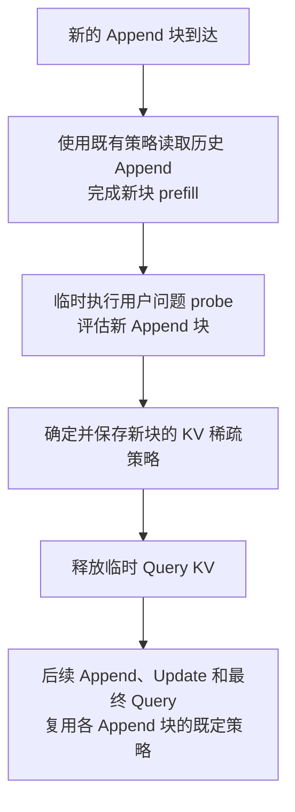

# 基于 Query probe 的 Append KV 块稀疏设计

## 研究目标

在流式 RAG 预填充过程中，利用提前获得的用户问题判断 Append 知识块的重要性，为每个 Append 块建立后续读取时使用的 KV block（KV 块）稀疏策略，减少后续注意力对历史 KV 的访问与计算。

**当前确定执行流程、策略复用关系及每块 16 token 的稀疏选择粒度；probe 评分方法、稀疏选择算法及其余参数暂不确定。** 回答质量与实际性能收益需要通过实验验证。

## 基本对象与策略含义

| 对象 | 含义 |
| --- | --- |
| Append 块 $A_i$ | 第 $i$ 个到达并保留在请求中的知识块，可能覆盖多个 KV 块 |
| KV 块 | 注意力稀疏选择的基本单位，初始采用当前 vLLM 默认的每块 16 token，具体缓存映射待实现时确定 |
| 用户问题 $Q$ | 请求开始时可获得，用于中途 probe，并在正式回答前作为最终 Query 输入 |
| Query probe | 在当前上下文之后临时执行用户问题的前向计算，为刚完成的 Append 块提供评分依据 |
| 稀疏策略 $S_i$ | 绑定到 $A_i$，规定后续 token 读取 $A_i$ 时保留哪些 KV 块 |

**策略绑定在被关注的 Append 块上。**$S_i$ 控制后续 token 如何读取 $A_i$，而 $A_i$ 在自身 prefill 时如何读取更早的 $A_j$，由更早确定的 $S_j$ 控制。

稀疏度描述跳过的 KV 块比例，但执行时仍需明确保留哪些块。本文用 $S_i$ 表示这份选择规则或结果，不预设仅凭一个比例就能完成执行。

这里的知识块、调度器一次执行的 prefill chunk、KV 缓存页及注意力计算 tile 是不同概念。一个 Append 块即使被拆成多次调度执行，也仍对应一次完整的 probe 与策略确定过程。

## 初始实验规模

- **稀疏选择粒度固定为 16 token。** 沿用当前 KV 缓存块大小；512 token 的 Append 在块边界对齐时对应 32 个 KV 块，足以进行块级选择。
- **沿用现有上下文长度与数据规模。** 在当前机器能够运行的模型和上下文预算内验证方案，暂不通过扩展上下文增加候选块数量。
- **区分选择粒度与计算粒度。** kernel 的计算 tile 可以覆盖多个缓存块，实现时仍需确认跳过选定 KV 块能实际减少计算，不能将每块 16 token 直接视为性能保证。
- **单独统计 probe 成本。** 在显存和计算资源有限的条件下，记录临时 KV 的峰值占用及每次 probe 的耗时，评估整体收益。

## Append 到达后的处理流程

对于新到达的 $A_i$，依次完成以下步骤：

1. **读取既有策略。** 取得之前 Append 块已经确定的 $S_1$ 到 $S_{i-1}$，作为本轮读取历史 Append KV 的依据。
2. **完成新 Append 的 prefill。** $A_i$ 对历史 $A_j$ 的注意力遵循 $S_j$。当前 Append 内部保留正常的因果注意力，生成并保存自身 KV。
3. **执行用户问题 probe。** 在包含 $A_i$ 的上下文上，临时执行用户问题的前向计算，获得用于评估 $A_i$ 的信息。
4. **确定新策略。** 根据 probe 结果生成 $S_i$，记录 $A_i$ 的 KV 块映射及后续读取策略。具体评分、保留预算和选择方式暂不指定。
5. **清理临时状态并发布策略。** 释放 probe 的临时 Query KV，后续 Append、Update 和最终 Query 读取 $A_i$ 时使用 $S_i$。

新块先使用旧策略完成自身计算，再通过 probe 确定自己今后被读取时的策略，避免用尚未产生的评分决定自身 prefill 的历史读取范围。

首个 Append 块到达时，没有历史 Append 策略需要读取；完成自身 prefill 后，同样执行 probe 并生成 $S_1$。

## 不同阶段如何使用策略

| 执行阶段 | 读取历史 Append 的方式 | 当前阶段的处理 |
| --- | --- | --- |
| 新 Append $A_i$ 的 prefill | 对每个历史 $A_j$ 使用已确定的 $S_j$ | 当前块内部保留因果注意力，完成后执行 probe |
| 用户问题 probe | 对历史 Append 的读取方式需在实验配置中明确 | 评估刚完成的 Append，产生其策略依据 |
| Update 的 prefill 或重算 | 对每个已就绪的 $A_j$ 使用 $S_j$ | 保留原有 Update 替换、失效与重算流程 |
| 最终 Query 的 prefill | 对每个已就绪的 $A_j$ 使用 $S_j$ | 正式计算问题表示，并进入回答阶段 |

例如，$A_1$ 完成后得到 $S_1$；$A_2$ 在 prefill 时按照 $S_1$ 读取 $A_1$，随后通过 probe 得到 $S_2$；$A_3$ 再分别按照 $S_1$、$S_2$ 读取这两个历史块。后续 Update 和最终 Query 也分别使用这些既定策略。

**最终 Query 对 Append 的读取同样采用稀疏策略。** 它需要在最终上下文上正式执行，不能直接复用中途 probe 的 Query KV。

当前设计不要求在后续 Append 到达或 Update 改变时重新评估旧块；已经确定的 $S_j$ 持续复用。是否增加重新评分机制，以及回答生成阶段是否继续使用这些策略，留待后续明确。

## Probe 的执行约定

**Probe 只提供评分依据，其临时 Query token 和 KV 不写入正式提示词，也不产生正式回答。** 执行后应保留已完成的 Append KV，并清理 probe 的临时状态。

为避免第一次评估新块时就先屏蔽它，建议初始实验约定：probe 对当前待评估 $A_i$ 的 KV 块完整可见，对更早 Append 的读取沿用既有策略。该约定需要在实验中记录，并可与全量可见的 probe 做对照。

以下细节仍需在实现或实验配置中确定：

- **评分信息与选择方法：** 使用哪些层、哪些头、怎样聚合 probe 信息，以及如何得到 KV 块选择。
- **Probe 的上下文：** 是否纳入当前已提交的 Update；若纳入，明确使用哪个版本，避免读取更新中的中间状态。
- **策略共享粒度：** 不同读取 token、层和注意力头是否共享同一组保留块，或在同一块策略下进一步细化。
- **策略发布时序：** 初始实现可先完成一个 Append 的 prefill、probe 和策略发布，再允许后续计算依赖该策略；并发执行时需定义未就绪策略的处理方式。

## 实现时需要保持的约束

- **保留 Append KV。** 第一版通过跳过部分 KV 块读取来减少注意力计算，保留完整缓存便于对照与调整策略，不将稀疏读取直接等同于删除 KV。
- **保证策略与缓存对应。** 记录 Append 标识、实际 token 范围和 KV 块映射。缓存位置或内容变化时，需要更新映射或使旧策略失效。
- **不回写既有表示。** $S_i$ 发布后影响未来读取，不追溯修改 $A_i$ 或更早 Append 已经算出的 KV；新 Append 的表示已受到之前稀疏策略影响。
- **保留因果和位置语义。** 稀疏选择需要与因果约束、padding 屏蔽共同生效，不能因跳过 KV 块而改变原有逻辑位置。
- **明确优化范围。** 本方案首先针对读取 Append KV 的注意力；系统提示、Update 自身及其他上下文的可见规则沿用原流程，额外裁剪需要单独设计。
- **验证真正跳过计算。** 底层应根据保留块执行注意力，不能仅凭输出 mask 或名义稀疏率推断性能收益。具体使用 FlashInfer 还是现有 Triton 后端，待实现时选择。

## 实验验证

以相同模型、数据、事件时间和生成设置下的完整注意力作为基线，评估整个流程引入的质量变化与性能收益。

- **回答质量：** 统计数据集对应的 EM、F1 等指标，重点观察跨块推理问题和最终 Query 稀疏后的变化。
- **实际稀疏情况：** 记录每个 Append 的 KV 块数、保留块数，以及各执行阶段实际访问的块数。
- **端到端性能：** 分别记录 Append prefill、probe、策略构造、Update、最终 Query 的耗时，并统计 TTFT、请求总耗时及吞吐。
- **额外资源：** 记录 probe 临时 KV、策略元数据的显存占用，以及新增调度、同步与索引构造开销。
- **收益归因：** 可在相同块预算下与随机选择、固定选择做对照，并对比最终 Query 完整读取 Append 的结果，区分选择方法与应用阶段的影响。

**收益需要覆盖每次 Append 新增的 probe 与策略维护成本。** 仅有较高的 KV 块跳过比例，尚不能证明端到端加速或回答质量满足要求。
