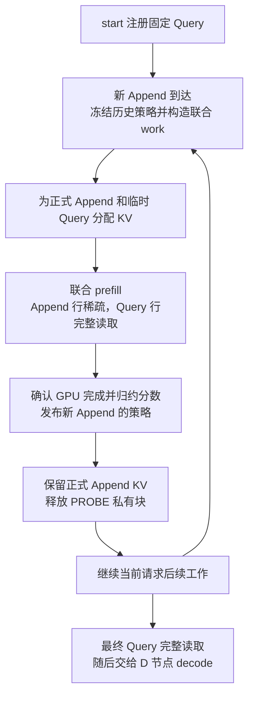

# 基于 Query probe 的 Append KV 块稀疏设计

当前 P/D 交接由 D 生成全部回答；P-only 使用 `prefill_ready` 控制事件测量 P 侧 TTFT。协议、兼容字段与验证命令见 [P/D 交接说明](scripts/server/PD-Handoff.md)。

## 目标与当前决策

在流式 RAG 预填充过程中，将新 Append 知识块与提前获得的用户问题拼成一次联合 prefill。Append token 按已发布的策略稀疏读取历史 Append；临时 Query token 完整读取当前有效前缀，并用于评估新块中的 KV block（KV 块）。评分完成后发布新块策略，供后续 Append 和 Update 使用，减少注意力计算与读取开销。

**实际评分和选择单位是 KV block，Append chunk 是事件、评分触发及预算分配单位。** 第一版已接入当前 Triton、TP=1、eager 执行路径；下文保留设计依据，具体字段和验证入口见“当前实现”。性能和回答质量仍待独立实验。

| 项目 | 当前约定或建议 |
| --- | --- |
| 已确定的选择粒度 | 每个 KV 块 16 token，沿用当前缓存配置 |
| 已确定的第一版评分实验 | 同时记录原始注意力总量和长度校正分数，在每个新 Append 内按固定保留比例选择块 |
| 建议的 Query 入口 | 在现有 `/v1/prompt_stream/start` 中增加 `probe_query` 字段 |
| 已确定的执行方式 | 新 Append 与临时 Query 联合 prefill；预算允许时一次模型 forward 完成 |
| 已确定的行级注意力 | Append 行使用历史稀疏策略；Query 行完整因果读取，不应用块选择 |
| 建议的 probe 上下文 | 固定模板、全部历史 Append 和当前新 Append，第一版不纳入 Update |
| 建议的临时 KV 存储 | 同次 forward 分别写正式 Append 段与私有 `PROBE` 段，完成后只释放临时块 |
| 建议的首个评分层 | 最后一个 Transformer attention 层，用作基线；后续对照中间层 |
| 建议的第一版作用范围 | Append 和 Update 的 prefill 使用历史块策略；最终 Query 与 decode 完整读取有效 KV |
| 建议的边界处理 | 跨 chunk、跨模板边界或未填满的 KV 块保留，不参与可淘汰块预算 |
| 实验规模 | 沿用当前模型、上下文长度和数据规模，记录 probe 带来的计算及显存开销 |

联合执行和行级可见范围是当前主方案。最终 Query 稀疏和 decode 稀疏分别作为后续实验选项；第一版的 probe Query 始终完整因果读取。选择算法和评分层的优劣仍需通过实验判断。

## 对象与系统现状

| 符号或对象 | 含义 |
| --- | --- |
| $A_i$ | 第 $i$ 个非空 Append 事件对应的知识块，可被调度器拆成多次 prefill |
| $B_b$ | 一个物理缓存页对应的逻辑 KV 块，通常含 16 个有效 token |
| $Q$ | 提前注册的问题后缀，包含与正式 finish 一致的模板边界 |
| $S_i$ | 为 $A_i$ 确定的保留块集合及保护块信息 |
| $\rho$ | 每个 Append 内可选择块的保留比例，实验参数 |
| Probe attempt | 某次联合 Append / Query 执行的评分尝试，具有独立标识、快照和进度 |

**策略绑定在被读取的 Append 块上。** $A_i$ 自身的 prefill 使用历史 $S_j$，其中 $j<i$；$A_i$ 完成后产生的 $S_i$ 影响后续读取，不追溯修改已经计算的 KV。

当前代码提供了以下基础：

- [REST 协议](../vllm/entrypoints/serve/prompt_stream/protocol.py) 已有 start、event、finish、abort 路径。start 传固定模板，最终问题通过 finish 的 `prompt_finished` 事件传入。
- [请求状态与执行视图](../vllm/v1/request.py) 已有 `PREFIX_APPEND`、`UPDATE`、`QUESTION` 三种执行阶段，以及正式 KV 段和私有 `PROBE` 段。`PREFIX_APPEND` 存模板和 Append；`UPDATE` 存更新快照和最终问题。
- [KV manager](../vllm/v1/core/kv_cache_manager.py) 根据执行视图决定读取哪些段、向哪个段分配和写入 KV。联合执行通过 allocation targets 描述同次 work 的正式段和私有段写入范围。
- 现有 masked padding 将整个 `PREFIX_APPEND` 的尾部对齐到缓存块边界，再拼接 `UPDATE`。它表达一个尾部 padding 区间，**没有为每个 Append 单独插入永久空洞**。
- [Triton attention](../vllm/v1/attention/backends/triton_attn.py) 已接收 padding 元数据，并已接入独立的稀疏块选择元数据和 probe 评分回包。

## 用户 Query 的入口和生命周期

### 通过现有 start 注册

`PromptStreamStartRequest` 已增加可选字符串字段 `probe_query`，由 P 节点分词后，经 `EngineClient`、`AsyncLLM`、`EngineCoreRequest` 传入长期 `Request`。Query 必须在首次 Append 被处理前注册。

第一版无须新增独立 REST endpoint。服务端在准备新 Append 的执行 work 时自动附加临时 Query，客户端继续发送普通 Append / Update 事件。若以后需要问题晚到或中途修改，再设计带版本的 Query 更新事件及历史 KV 重建规则。

`probe_query` 的协议语义建议直接定义为：**与本请求最终 `finish.event.text` 相同的完整问题后缀**。当前 replay 的 [prompt.py](scripts/replay/common/prompt.py) 已生成 `finish_text`，其中包含问题和模板后缀，可以在 start 时提前发送这段文本。

- 字段允许省略以兼容旧请求；显式启用 probe 稀疏而未提供 Query 时，应在 start 阶段报错。
- 使用服务端与 finish 一致的分词规则，避免重复添加特殊 token。token ID 和有效评分位置保存在服务端，客户端继续传文本。
- 提前注册只保存元数据，不把问题插到正式 Append 前面，不触发生成，也不提前结束输入流。
- 第一版可以对整个问题后缀的有效 token 聚合，明确记录该口径。仅聚合问题正文的实验需提供服务端校验过的 token 范围，不能假设模板后缀没有影响。
- Query 字段与稀疏配置属于请求控制参数，须与 `sampling_params` 分开处理。

### 请求级生命周期

| 时机 | Query 状态与处理 |
| --- | --- |
| start | 保存规范化 token IDs、内容摘要和初始版本，保持正式 prompt 仍为固定模板 |
| Append 准备调度 | 引用已注册 Query 创建联合 work 和 probe attempt，冻结历史前缀、目标 Append、配置与策略版本 |
| 联合执行中 | 分别记录 Append、临时 Query 的完成进度及评分累加状态，不改正式问题进度 |
| 联合执行与评分完成 | 确认正式 Append KV 已完成，发布 $S_i$，清理临时 Query KV；保留 Query token IDs 供下一次使用 |
| finish | 校验正式问题与注册后缀的 token IDs 一致，按原流程入队唯一的正式 `QUESTION` work |
| abort 或请求结束 | 清理 Query 元数据、未完成 probe、评分状态和私有 KV |

第一版对 finish 中问题不一致的情况，在入队前明确拒绝。直接更换 Query 后只让最终阶段恢复完整读取，不能撤销此前基于旧问题计算出的稀疏 Append KV；要支持问题变化，需要重新建立对应请求上下文。

代理也需要同步处理字段：[proxy_server.py](scripts/server/proxy_server.py) 的 `_build_prefill_start_request()` 应向 P 传递 Query，`_build_decode_base_request()` 应移除 probe 专用字段，避免把它们当作普通生成参数发给 D。Stable KV proxy 共用这部分辅助函数，也需覆盖验证。

## Append 与 Query 的联合 prefill

### 同次 forward，按行决定可见范围

实现沿用 `PREFIX_APPEND` work，通过 `probe_attempt_id` 和 execution view 的 `probe_start` 表示联合执行，不增加外部事件或新的 phase 枚举。其有效输入按 $[A_i;Q]$ 排列，布局所需 padding 单独标记。它不产生额外外部 source 事件，不把 Query 计入 Append 内容版本，也不借用正式 `QUESTION` 阶段。

对同一请求，本次 attention 的行级规则如下：

| 当前 token 行 | 历史 Append | 当前 $A_i$ | 临时 Query |
| --- | --- | --- | --- |
| Append 行 | 按已发布 $S_j$ 读取，模板和保护块保留 | 完整因果读取 | 不可见 |
| Query 行 | 全部有效 KV 可见，不应用 $S_j$ | 全部有效 KV 可见 | 完整因果读取，包括自身 |

**Query 不需要等待 Append 完成整个模型。** 每一层先为本次输入计算 QKV，完成该层新 KV 写入，再按上述可见范围执行 attention。Query 在该层需要的是 Append 进入该层后生成的 K/V；下一层所需表示由这一层统一产生。因果屏蔽保证 Append 不依赖后面的 Query，因此不存在循环依赖。

在位置、可见范围和已有缓存相同的前提下，这与先完整执行 Append、再单独执行 dense Query 的计算语义一致；数值结果允许存在不同 kernel 或 batch 形状造成的浮点误差。Query 完整读取的历史 KV，仍可能是之前稀疏计算产生的表示。

同一次模型 forward 可以在各层共用 QKV 投影和 MLP 的批处理，再分别调用 Append 稀疏 attention 与 Query dense attention。也可以实现一个支持行级 mask 的算子。**联合 prefill 不要求所有 attention 行使用同一个块列表，也不要求只启动一个 attention kernel。**

### 调度与完成确认

每个非空 Append 事件对应一次评分尝试，预算允许时将整个 $A_i$ 和 $Q$ 放进一次模型 forward。start 的模板 bootstrap、空 Append 和事件重试不额外产生一次评分发布。

第一版对同一请求串行处理联合 work、策略发布与后续依赖工作。后续事件可以接收并排队，但下一项 work 要等本次策略就绪；联合 work 不越过更早已入队的 Update。不同请求仍按现有调度优先级竞争资源。

需要分别记录真实 Append KV 的完成状态与策略就绪状态。只有 GPU 确认完成的正式 KV 才能按原规则发布稳定完整块；只有评分归约并发布 $S_i$ 后，依赖该策略的后续 work 才能运行。不能用乐观推进的 `num_computed_tokens` 代替完成确认。

联合执行期间，后续 Append 不能覆写本次使用的尾部 padding，已有在途 Update 也不能与其发生布局冲突。联合 work 消耗真实 token 预算；存在可执行联合 work 的请求不能进入仅等待外部事件的 dormant 状态，等待结果时不能重复创建 attempt。

### 预算不足时的分批规则

一次外部 Append 事件不保证一定只需一次模型 forward。调度器的 token 预算、模型长度及 KV 容量仍是硬约束。

- 优先将完整 $A_i$ 与 $Q$ 联合调度；对已有 chunked prefill，可尽量让最后一段 Append 与 Query 同批执行。
- 若 Append 必须拆分，前几批仅处理 Append，所有部分保持相同的历史策略；Query 行只能出现在完整 Append 之后的逻辑位置。
- Query 也可跨批执行，其后续 token 继续读取私有 Query KV。块分数按实际参与评分的全部 Query 行累加，最后统一归一化，只发布一次 $S_i$。
- 调度预算不足时允许 Query 单独形成后续批次，作为显式记录的回退路径；不能截断 Append、省略 Query 或悄悄改变 mask 来满足预算。

记录每个 attempt 的模型 forward 次数、联合执行 token 数及拆分原因。发生拆分或恢复的请求不计为“一次 forward 完成”。

### 预期性能收益

联合执行有机会减少一次独立模型调用、调度往返与相关启动开销，并让投影和 MLP 使用更大的 token batch。若两类 attention 分别调用 kernel，attention 的启动次数未必减少。

Append 与 Query 仍要经过完整模型层，Query 仍做完整因果 attention，额外评分扫描也仍有成本。混合行元数据、私有 KV 分配和算子形状变化可能抵消部分收益。因此应以相同 mask 的分开执行版本作为性能对照，测量端到端耗时；不能预先承诺固定加速比。

## 临时 Query KV 的存储与释放

### 同次执行，分别拥有 KV

联合 prefill 仍建议使用独立 `PROBE` 段。**模型执行合并，KV 的所有权和完成进度分别管理。** 新 Append KV 写入正式 `PREFIX_APPEND`；Query KV 写入仅属于本次 attempt 的私有段。

设历史真实前缀长度为 $L_{i-1}$，加入 $A_i$ 后为 $L_i$，对齐后的物理长度为：

$$
P_i=16\left\lceil\frac{L_i}{16}\right\rceil
$$

联合执行视图按以下范围组织：

| 内容 | 物理 token 范围 | 写入与后续处理 |
| --- | --- | --- |
| 已完成历史前缀 | $[0,L_{i-1})$ | 复用其 KV，不重新计算 |
| 当前新 Append | $[L_{i-1},L_i)$ | 写正式段，执行完成后保留 |
| 当前尾部 padding | $[L_i,P_i)$ | 按已有机制屏蔽，不能参与评分或作为有效历史 |
| 临时 Query | $[P_i,P_i+\lvert Q\rvert)$ | 写私有段，评分完成且无在途访问后释放 |

Query 的物理位置从 $P_i$ 开始，RoPE 的语义位置从 $L_i$ 开始。Append 使用正常的真实 token 语义位置。`required_segments` 可由 `PREFIX_APPEND + PROBE` 组成，KV manager 通过 `get_prompt_stream_allocation_targets()` 将同一物理执行区间拆为两段的本地写入范围，单独计算各段进度。

KV manager 须为 Append 新增正式块和 Query 私有块完成一次一致的资源预留；worker 根据逐 token 的 slot mapping 写入对应物理块。可以分步骤分配，失败时必须回滚本次新增分配，保留已有前缀，不能让只分配成功一个段的 work 进入执行。

Query 私有段从新块开始，因此释放不需要回滚正式 Append 内容或复制其尾块。下次 Append 从 $L_i$ 接着写入，覆盖先前的尾部 padding；不能从 $P_i$ 接着追加并把这个空洞永久保留。每个时刻只保留当前前缀末尾所需的对齐区间。

本次复合 work 应分别记录 Append 已计算数、Query 已计算数及布局游标；不能把联合输入的总进度直接写成正式 Append 进度。若 Query 跨 scheduler step，其私有 KV 必须保留到整个评分结束。

私有段绑定 request、probe attempt 和缓存代次。共享读取的历史块及本次新写的正式块，需要保持到所有 GPU 引用结束；清理 Query 不能释放正式 Append 的所有权。

### 为什么不把 Query 永久改成 padding

| 方案 | 分析 |
| --- | --- |
| 写入正式 Append 后，留下 Query 长度的 padding | 多次 probe 会累积内部空洞，增加物理长度，并要求多段 padding、位置映射和传输协议一起扩展 |
| 写入正式尾部，再回滚长度和释放尾部块 | 需要同时回滚 worker 视图、计算进度、块引用、传输状态；尾部共享块还可能需要备份或写时复制 |
| 私有 PROBE 段 | 复用已有的前缀尾部对齐，只对临时 Query 单独分配和释放，适合作为初始实现 |

主路径从一开始采用联合 work。独立私有段解决 KV 生命周期问题，多写入范围解决同次 forward 的落点问题；无需因为分段存储而将模型执行拆成两次。分开执行仅保留为正确性、性能对照以及预算不足或恢复时的回退路径。

### 释放清单与传输清单必须分开

`get_prompt_stream_segment_keys()` 用于所有权清理，启用 probe 时包含第三个 key；`get_prompt_stream_blocks()` 显式只导出两个正式段，两份清单已经分开。

- **所有权与清理清单：** 包含正式段、当前 probe 私有段及其待释放资源。
- **本轮执行清单：** 根据 execution view 选择，例如联合 work 的 `PREFIX_APPEND + PROBE`。
- **最终 P/D 传输清单：** 继续只包含 `PREFIX_APPEND + UPDATE`，其中包含正式 Question KV。

probe KV 不参与前缀缓存共享、早期稳定 KV push 或最终传输。回包、abort、抢占、异常路径都必须等 GPU 不再使用对应私有块后再归还 block pool；发起清理不等于 GPU 引用已经结束。

### 如果以后需要让 probe 读取 Update

这会将评分绑定到具体 Update 快照，必须冻结已提交的 Update 版本和 Append epoch。新 Append 可能使旧 Update 的依赖失效，不能只因为缓存中存在旧 Update 就将其拼进 probe；应先明确重算及可用性规则。不能用刚到达但尚未完成的 Update 内容冒充可用 KV。

`UPDATE` 的尾部可能没有对齐。直接把 `UPDATE + PROBE` 的 block table 拼起来，会把 Query 放到错误的物理偏移。可选实现包括复制 Update 的最后一个部分块到私有区后追加 Query，或增加 Update 尾部对齐并扩展多 padding 区间表示。第一版选择不纳入 Update，从而复用现有单区间布局。

## Append chunk 边界与 KV 块归属

**chunk 边界需要显式记录，不能直接忽略。** Append 事件连续写入 `PREFIX_APPEND`，相邻 chunk 可能共享一个物理 KV 块；模板与首个 Append 也可能共享块。

服务端在事件分词完成后记录每个 $A_i$ 的真实 token 半开区间，以及 source ID、chunk ID、sequence、内容摘要和 Append epoch。范围使用实际 token 日志坐标，不能按字符数推测。

第一版将 KV 块分成两类：

- **可选择块：** 16 个真实 token 全部属于同一个已完成的 Append，且不包含模板或 padding。
- **保护块：** 跨模板或 Append 边界、包含当前部分尾块，或归属尚不确定的块。后续读取时保留有效 token，padding 继续屏蔽。

例如，假设 $A_1$ 从块边界开始且有 30 token。它占满第一个 16-token 块，并占第二块的前 14 个位置；随后 $A_2$ 会接着填入第二块的剩余位置。第二块属于两个 chunk，应保持可见，不能因为 $A_1$ 的策略而把 $A_2$ 的开头一起跳过。

这里不需要给每个 Append 增加永久对齐 padding。当前前缀的临时尾部 padding 仍可被未来真实 Append 覆盖；与它共享的尾块已经被保护，因此也不需要对该部分的旧评分进行复用。

跨边界块即使后来填满，也继续按混合归属保护。一个 Append 没有完整独占块时，直接保留其所有有效 KV；可以记录一次无选择收益的 probe，后续再评估跳过这类 probe 的优化。

保护块不计入可淘汰预算，但必须计入实际读取量。例如可选择块保留一半，并不代表整个 Append 恰好跳过一半 token。实验需分别报告保护块、可选择块和最终保留块数量。

## 评分与固定比例选择

### 统计口径

参考 [FusionRAG 的 Query-Guided Selection](https://arxiv.org/html/2601.12904v1#S3.SS2)，第一版可使用最后一个 attention 层的 Query 到上下文信号。我们的 Query probe 会读取当前前缀，与只对问题本身做前向计算的方式有所区别。最后层只是基线，后续应对照中间层。

第一版 probe Query 对模板、全部历史 Append 和当前待评估 $A_i$ 完整可见，不使用任何 $S_j$ 做块稀疏。它保持 Query 内部的因果关系，继续屏蔽 padding。评分只采集联合输入中的 Query 行，候选范围仅为当前新 Append；Append 行自己的稀疏注意力不混入分数。

设 $m$ 为参与评分的问题 token 数，$H$ 为 Query head 数，$P_{h,q,t}$ 为选定层的实际 softmax 权重。对新块中的 $B_b$ 记录原始注意力总量：

$$
s_b=\frac{1}{Hm}\sum_{h=1}^{H}\sum_{q=1}^{m}
\sum_{t\in B_b}P_{h,q,t}
$$

再记录相对于均匀注意力的校正分数：

$$
r_b=\frac{1}{Hm}\sum_{h=1}^{H}\sum_{q=1}^{m}
\frac{N_{h,q}}{n_b}\sum_{t\in B_b}P_{h,q,t}
$$

其中 $N_{h,q}$ 是该行真正参与 softmax 的有效 KV 数，包含当行可见的模板、历史 Append、当前 Append 和 Query 前缀，排除 padding 和未来 token；probe 行没有因块选择而排除的历史位置；$n_b$ 为该块的有效 token 数。可选择块的 $n_b$ 固定为 16。

$r_b$ 用于检查随上下文增长产生的长度偏差。它不消除上下文内容、Query 表示及历史 KV 已受稀疏计算影响等因素，不能作为跨 probe 的绝对相关性保证。第一版不将不同时间的 $r_b$ 放入统一全局阈值进行淘汰。

### 从块分数产生策略

令 $\mathcal E_i$ 为 $A_i$ 的可选择块集合，$\mathcal G_i$ 为与其相关的保护块集合。第一版在当前 Append 的可选择块集合内按原始分数 $s_b$ 做 Top-K：

$$
k_i=\left\lceil\rho|\mathcal E_i|\right\rceil,
\qquad
S_i=\mathcal G_i\cup\operatorname{TopK}_{b\in\mathcal E_i}(s_b,k_i)
$$

$\rho$ 由实验配置给出；全保留对应 $\rho=1$。分数并列时按逻辑块编号稳定选择。多个 chunk 共用的保护块在实际执行时去重，选中的 KV 块按原逻辑顺序访问。

第一版将聚合后的选择结果共享给各层和 Query heads，减少元数据和实验变量。分层、分头选择及按块重要性动态调整 $\rho$，作为后续实验。

### 在 worker 中提取分数

[Qwen2 模型路径](../vllm/model_executor/models/qwen2.py) 在 Q/K 投影和 RoPE 后调用 attention。评分应使用该层实际进入 attention 的 Q，以及对应缓存中的 K，并保持 GQA 的 Q-head 到 KV-head 映射。不能用 attention 输出向量代替权重。

只采集最后一层评分，仍需要 Query 的前置模型层产生该层输入；这些层与 Append 在联合 forward 中一起执行，不能把 probe 成本估计成只执行一个层。

当前实现不返回完整注意力矩阵。在联合 forward 的最后 attention 层保存每个 Query 行、每个 head 的完整 softmax 分母（log-sum-exp，LSE）；辅助评分 kernel 只重算当前 Append 候选块的 QK，并使用该 LSE 恢复归一化权重。不再次运行模型，也不再次扫描全部历史 K。

如果只额外计算当前 Append 的 QK，需要从原 attention 获取严格对应的全局归一化量。**只在当前 chunk 内做 softmax 会改变分数含义**，不能将其当作实际的全上下文注意力总量。

在线 softmax 的中间 tile 权重尚未按最终分母归一化，不能直接累加为最终分数。评分必须等本层 attention 得到最终 LSE 后再执行；候选块只是分子范围，分母始终包含 Query 实际可见的全部历史与因果 Query 前缀。FP16、BF16、GQA、分页布局与跨批 Query 均用显式 softmax 参考核对。

## 策略传给后续计算的方式

### 策略状态与元数据

建议在 Request 中保存每个 Append 的逻辑区间、可选择块和保护块、$s_b$、$r_b$、保留集合、Query 版本、评分配置及策略版本。记录 probe 使用的 Append epoch 和历史策略快照，便于复现。

长期策略使用逻辑块编号，不能只保存 block pool 的物理 ID；抢占和恢复后，物理块号可能改变。调度时通过当前 block table 将逻辑选择映射到实际缓存。

一次 work 开始时冻结它使用的策略版本，并经调度输出传到 worker。对于联合 work，单个请求级阶段标记不足以决定 mask：worker 必须携带 Append 行与 Query 行的范围、各行读取规则、各段写入范围及 padding 信息。物理 slot mapping 决定写到哪里，行角色决定读哪些 KV，两者分别描述。动态 batch 的插入、删除和重排都要同步这些元数据。

建议的数据传递路径为：

1. Request 保存 Query、Append 范围、已发布策略和 probe 状态。
2. `SchedulerOutput` 及请求刷新数据携带复合执行类型、分段进度、快照与选择信息。
3. `GPUModelRunner` 和 input batch 建立逐行角色、分段写入映射及 attention 元数据。
4. attention 层让 Append 行执行块稀疏、Query 行执行完整因果注意力，并在选定层归约分数。
5. `ModelRunnerOutput` 通过专用字段返回 Append / Query 各自的完成进度、attempt 标识与块分数；scheduler 校验版本后发布策略。

这些评分结果不应借用生成 token、logprobs 或对外 SSE 文本通道。整个联合 work 不进入正式采样、停止判断和请求完成流程，也不推进正式 `question_num_computed_tokens`。尤其不能因为批次末尾是 Query token，就沿用普通 prefill 的末 token 采样路径；正式生成仍由 finish 触发。

### 推荐的第一版作用范围

| 阶段 | 对历史 Append 的读取 | 其他约束 |
| --- | --- | --- |
| 新 Append prefill | 使用已经发布的 $S_j$ | 当前 Append 内部完整因果注意力，模板与保护块保留 |
| 联合 prefill 中的 Query probe | 完整读取全部有效历史 Append 和当前新 Append | 保持因果与 padding mask，Query KV 写入私有段 |
| Update prefill 或重算 | 使用当前 work 冻结的历史策略 | Update 内部保留正常因果关系，沿用原版本和 LCP 规则 |
| 最终 Query prefill | 完整读取所有有效 Append 和最终 Update KV | 重新计算正式 Query，继续屏蔽布局 padding |
| D 节点 decode | 完整读取已传输的有效 KV | 使用原有缓存和布局信息，无需读取选择集合 |

这个范围优先加速反复发生的知识块计算，同时允许最终问题和生成过程读取所有保留在缓存中的信息。由于没有删除未选中的 KV，最终阶段恢复完整读取可以通过选择完整访问路径实现。

**完整读取不会把历史 KV 恢复成完整注意力 prefill 的结果。** 后来的 Append 和 Update 已经在稀疏历史依赖下产生了表示；最终 Query 能看到这些表示的全部位置，但无法自动补回此前省略的跨块计算。质量仍需要端到端评估。

### 最终 Query 和 decode 稀疏作为独立实验

建议配置按阶段指定作用范围，而不是一个全局布尔开关。依次比较只稀疏 Append、稀疏 Append 与 Update、再加入最终 Query、最后加入 decode。

如果在 D 节点启用 decode 稀疏，最终传输元数据还需携带逻辑块选择、保护范围、策略版本与布局标识。D 必须按自己的 block table 映射，不能使用 P 的物理块 ID。P/D 应校验策略兼容性，并明确接收后逐 token decode 的可见规则。

第一版 D 完整读取，因此传输仍需包含全部正式 KV；注意力计算节省不等于显存容量或 KV 传输量节省。probe 元数据仅作为实验记录保留，临时 KV 始终不传输。

## Attention 后端的实现边界

P 通过 `CHUNK_SPARSE_ATTN` 显式选择自定义算子，dense 与 sparse 共用执行路径，继续使用现有分段、padding 与语义位置机制。D 显式选择 `TRITON_ATTN`，保留原 `unified_attention` 路由，只屏蔽 padding，完整读取全部正式 KV，不承接 probe 或 decode 块稀疏。FlashInfer 的稀疏接口可以作为算子实验或后续替代后端，需要另行对接分页布局。

自定义后端继承 Triton 的 KV 形状、stride 和写入格式，NIXL 握手将这两个后端识别为同一 KV 格式家族。模型、dtype、协议版本以及实际布局的兼容检查保持启用，P/D 可以分别选择上述后端。

不要通过删减正式 block table 来实现稀疏读取。完整 block table 仍负责地址映射、KV 写入及最终完整读取；另外提供只读选择索引或位图，让 kernel 保持原逻辑位置遍历允许的 KV 块。

当前 [Triton kernel](../vllm/v1/attention/ops/triton_unified_attention.py) 按连续 tile 循环计算 QK 和 PV。实现需要让不选中的块实际绕过相应读取与计算，而不仅在算完之后将分数置为负无穷。

16-token KV 块与 kernel 的 tile 大小不一定相同。首个正确性版本可以先验证访问 mask；性能版本需要支持稀疏块遍历，或在 tile 聚合时处理部分选中的块，并按真实执行量报告收益。因果关系、padding、保护范围和逐行策略必须同时生效。

**Append / Query 的行边界也需要显式处理。** Query 的 KV 起点按 16 token 对齐，并不保证它与 attention 的 Query tile 边界一致。若一个 tile 同时包含 Append 行和 Query 行，不能给整个 tile 共用 Append 的稀疏块列表，否则会错误屏蔽 Query；也不能对所有行直接取消 mask，否则会改变 Append 的定义。

性能实现优先将两类行划分为独立的 attention 行组，分别执行稀疏与完整路径，再按原 token 顺序合回输出。正确性版本也可以让跨边界 tile 遍历两类行所需 KV 的并集，并对每一行施加各自 mask，但这种 tile 通常无法跳过历史块，其额外计算应计入统计。它不要求为真实 prompt 插入额外永久 padding。

上述划分发生在同一层内部，QKV 投影与 MLP 仍按联合输入处理。若接入 CUDA graph，还需覆盖行分组、动态选择索引及 batch 重排的更新，不能复用上一批过期元数据。

## 并发、恢复与资源约束

- **快照和回包校验：** 每次联合 work 冻结 Query 版本、历史已提交 Append epoch、本次目标 epoch、历史策略版本和 attempt 标识。迟到或已取消的 GPU 结果不得发布到新状态。
- **同请求写入隔离：** 联合 work 在途时，后续 Append 不能覆写它读取或写入的前缀尾块。第一版串行执行；其他请求仍可正常调度。
- **抢占恢复：** 私有 probe KV 可以丢弃并重试，但须先等待在途访问结束。保存逻辑 Query、Append 边界、分段完成进度和已发布策略，清除失效的物理映射。若 Append 已完成且 KV 仍有效，可仅重试 Query；若 Append 未完成或 KV 已失效，则按冻结策略恢复其计算。不能重复提交同一 Append 或重复发布评分。
- **历史 KV 重建：** 恢复已完成 Append 时，必须按原事件边界和原策略重建其历史读取关系。不能将所有历史 Append 合并成一次采用当前 mask 的 prefill，否则会改变原本的计算语义。已完成策略不重复生成；未完成 probe 在前缀恢复后重试。
- **策略与 Update 复用：** 第一版发布后冻结旧 $S_i$。若以后修改已有策略，依赖它的 Update KV 和 LCP 复用也需重新校验，不能只比较文本相同就复用。
- **资源预算：** 长度校验分别覆盖正式 prompt 和 $P_i+|Q|$ 的联合物理视图；调度预算计入新 Append、需要实际执行的 padding 与临时 Query。准入同时考虑新增正式块和 Query 私有块，统计峰值显存；分配失败只回滚本次新增资源，不能释放已有正式前缀。
- **失败策略：** 评分失败或资源不足时可显式配置为中止实验请求，或将当前新块标记为全保留并记录降级原因。后者只改变该块的后续策略，不宣称整条请求已经恢复成 dense prefill。
- **缓存与传输隔离：** 保持 prompt-stream 缓存不进入普通前缀缓存共享。稳定 KV push 只发布已完成的正式块，沿用其代次与恢复规则，避免把旧代次传输结果和新建 KV 混用。

## 涉及的模块

| 模块 | 实现职责 |
| --- | --- |
| [REST 协议与 serving](../vllm/entrypoints/serve/prompt_stream/serving.py) | Query 字段、服务端分词、finish 一致性、长度镜像与 probe 预算校验 |
| [Engine 协议](../vllm/engine/protocol.py)、[AsyncLLM](../vllm/v1/engine/async_llm.py)、[EngineCoreRequest](../vllm/v1/engine/__init__.py) | 将 Query 与稀疏配置传入长期请求，不混入采样参数 |
| [Request](../vllm/v1/request.py) | Append token 范围、Query 生命周期、带 probe attempt 的 PREFIX_APPEND work、多写入范围 view、策略版本和恢复规则 |
| [Scheduler](../vllm/v1/core/sched/scheduler.py) | 联合调度与预算拆分、分段完成确认、在途保护、结果发布和 dormant 判断 |
| [KV manager](../vllm/v1/core/kv_cache_manager.py) | 正式与私有段的一致分配、多写入范围、失败回滚与释放；拆分清理、执行和导出清单 |
| [调度输出](../vllm/v1/core/sched/output.py)、[GPUModelRunner](../vllm/v1/worker/gpu_model_runner.py)、[input batch](../vllm/v1/worker/gpu_input_batch.py) | Append / Query 行范围与读写元数据、batch 重排、物理和语义位置、不采样路径 |
| [ModelRunnerOutput](../vllm/v1/outputs.py) | 各段完成进度、专用评分结果及 attempt 标识，适配异步回包路径 |
| [Triton backend](../vllm/v1/attention/backends/triton_attn.py) 与 kernel | 混合行的 sparse / dense 路径、评分归约、块选择元数据、真正跳过 KV 块计算 |
| [普通 proxy](scripts/server/proxy_server.py)、[Stable KV proxy](scripts/server/stable_kv_proxy.py)、[replay](scripts/replay/common/prompt.py) | 提前发送同一问题后缀、正确过滤控制字段、输出实验统计 |

初始实现以当前单 GPU、TP=1 的 Qwen 路径验证。扩展到 TP 时需正确合并分片 Query heads 的分数，不能把单个 rank 的局部均值直接当作全模型均值。

## 当前实现

### 协议与执行入口

start 传入 `probe_query` 即启用功能，`probe_keep_ratio` 默认 `0.5`，允许范围为 `[0, 1]`。单独提供比例而没有 Query 会被拒绝。Query 由 P 分词，并在 finish 校验 token IDs 一致；固定版本为 `1`，内容摘要保存在返回统计中。

P 需使用 `--enforce-eager --attention-backend CHUNK_SPARSE_ATTN --prompt-stream-masked-padding --no-async-scheduling`，TP=1、KV block=16、KV dtype=auto。D 使用 `--attention-backend TRITON_ATTN --prompt-stream-masked-padding`，保持模型与 KV 布局一致。第一版用于普通一维 RoPE 的 full-attention 模型，功能回放使用 Qwen2.5-3B。

| 实现位置 | 已接入行为 |
| --- | --- |
| [Query 状态](../vllm/v1/query_probe.py) | 保存逻辑块归属、Query 版本、attempt、跨 step 分数和不可变 Top-K 策略 |
| [Request](../vllm/v1/request.py) | 联合执行视图、真实 Append 范围与摘要、完成后发布、按原事件边界恢复 |
| [KV manager](../vllm/v1/core/kv_cache_manager.py) | 同批检查两段总容量、独立分配 PROBE、完成后释放、正式导出排除 PROBE |
| [自定义后端](../vllm/v1/attention/backends/chunk_sparse_attn.py) | `CHUNK_SPARSE_ATTN` 固定调用新版算子，dense 使用完整页列表；复用 Triton KV 写入布局 |
| [稀疏算子](../vllm/v1/attention/ops/query_probe_attention.py) | 每页 16 token；整页不可见时在 K/V 读取和 QK/PV 前跳过；在 Append/probe 边界拆分行 tile |
| [GPU runner](../vllm/v1/worker/gpu_model_runner.py) | 按当前 batch 顺序绑定策略，最后 attention 层收集 Query 分数，临时输出不进入正式 token 流 |
| [功能 replay](scripts/replay/query_probe/README.md) | 读取独立 Append/PipelinePool 数据，经 proxy TTFT-only 回放，检查策略和私有页回收 |

评分使用最后层实际 Q/K 与该层完整 Query attention 的 LSE。GPU 辅助 kernel 只读取候选块 K，直接按 GQA 映射访问，不展开完整 FP32 K，也不在 attention 层内部执行 `.tolist()`。各请求的原始分数与长度校正分数留在 GPU，模型执行结束后统一归约并回传，Top-K 仍使用原始总量。生命周期、保留比例与评分口径保持一致。

性能路径使用运行时整数元数据描述请求、行范围和 padding，避免将请求长度编译为 Triton 常量。每层整批启动一次 attention kernel；32 行 Query tile 在 Append / probe 边界拆开，128-token KV tile 聚合最多 8 个保留的 16-token 逻辑页。紧凑页列表实际跳过丢弃页，原始 block table 与逻辑位置不变。padding 和未写入尾页在读取 K/V 前屏蔽，防止无效 KV 中的 NaN 污染结果。

选择 `CHUNK_SPARSE_ATTN` 的进程在没有 probe 行、没有需要跳过的块，以及执行最终 Query / decode 时，均使用同一个新版 kernel 的完整页列表，不在进程内回退到 `unified_attention`。当前 D 的启动命令单独选择 `TRITON_ATTN`，因此 D decode 使用 `unified_attention`。dense 不注册 probe，不计算块分数；只有 sparse 的临时 Query 在最后层额外输出 LSE 并评分。正式对照方案及复现方法见 [性能实验](scripts/replay/query_probe/PERFORMANCE.md)。

`prompt_stream_stats.query_probe` 返回 Query 摘要、比例、实际 forward 数、私有页累计释放数，以及每个 Append 的范围、摘要、候选块、两种分数和保留集合。每块的 `forward_count` 统计评分尝试所需批次，`joint_forward_count` 统计同批同时包含真实 Append 和 Query 的次数，`query_forward_count` 记录含 Query 行的批次数；没有将 Update 的失效 token 与 probe 私有页释放混在一起。

当前未启用独立的“先完整 Append、再完整 Query”对照模式；token 预算不足时仍按联合逻辑视图进行 chunked prefill。最终 Query 完整读取正式 KV，D 节点 decode 沿用完整 KV 读取。D 端质量和真实 P/D 传输不在这轮功能验证范围。

### 功能验证范围

CPU 测试覆盖联合完成提交、边界保护、跨 step Query 分数、迟到回包、恢复保留策略、总容量不足时分配无残留，以及 finish 不一致拒绝。GPU 测试以显式因果、padding 和逐行 mask 为参考，覆盖非连续页表、GQA、NHD/HND 布局以及 Append/Query 行边界。

真实数据回放包括功能校验与独立的 P 节点 TTFT 性能矩阵，尚未测量 D 节点生成质量或 EM/F1。默认输出位于 `research/scripts/replay/query_probe/results`；具体启动、参数和校验项见该目录 README。性能统计包含 probe、评分、调度与 HTTP 开销；质量与更多策略消融仍需单独实验。

## 实施顺序与验证

1. **先实现全保留的联合 prefill。** 贯通 Query 字段、复合 work、行范围、多段 KV 写入和评分；所有块保持可见，验证临时执行不会污染正式 prompt、输出和传输。主路径采用联合 forward，分开执行仅作为参考或回退。
2. **验证固定比例选择。** 记录原始分数与校正分数，构造保护块和 $S_i$；以完整 attention 加显式 mask 验证语义，再接入真正的块稀疏计算。
3. **启用 Append 与 Update 稀疏。** 完成事件边界、抢占恢复、Update 复用和 P/D 路径验证，再进行端到端质量与性能实验。
4. **扩展作用范围和评分方法。** 对照最终 Query / decode 稀疏、中间层评分以及动态预算，分别记录新增质量变化与开销。

关键正确性检查包括：

- 在相同历史策略、dense Query、位置和评分口径下，对比联合执行与分开执行的 Append KV、Query 表示及块分数，结果在数值容差内一致。两者不能使用不同的 Query mask。
- 全保留模式下，加入联合 probe 后的正式 token 布局与输出在相同后端允许的数值容差内对齐无 probe 基线，没有多余问题副本或永久空洞。
- Append 长度为 15、16、17 token 等边界情况，以及模板与 Append、相邻 Append 共页时，保护块和有效位置正确。
- 检查 Append / Query 行边界位于实际 Query tile 内部和边缘的情况，例如 31、32、33 等长度；Query 保持完整可见，Append 保持其稀疏 mask，分组输出顺序正确。
- 一个 Append 拆成多次 prefill、Query 跨 step、事件重试和空事件时，评分次数、累加分母与发布次数正确；两个段中任一个分配失败均无泄漏。
- probe 在途发生 abort、抢占、后续事件入队时，没有块提前释放、迟到结果覆盖或临时段泄漏。
- 稀疏 kernel 与相同可见范围的参考 attention 一致，包含 padding、GQA、因果关系和 batch 重排情况。
- finish 问题不一致时在正式入队前拒绝；P/D 导出没有 probe KV，D 完整读取包含全部正式缓存。

实验记录至少包含数据集 EM / F1、联合 work 耗时、TTFT、吞吐、attempt 次数、模型 forward 次数、拆分原因、Append / Query 各自执行 token 数、评分扫描开销、策略构造耗时、临时 KV 峰值、保护块数量和实际跳过块数量。联合 forward 的总耗时不能再与其中的 Append、Query 子项重复相加；细分成本通过 profiler 或相同配置的消融实验估计。probe 的临时释放单独统计，不混入现有 Update 失效 token 指标。

**端到端收益必须覆盖 probe、额外评分扫描、策略同步与调度开销。** 需要同时使用无 probe 的完整注意力基线、全保留但执行联合 probe 的对照，以及相同预算的随机或固定块选择，区分新增成本、评分价值和稀疏 kernel 本身的收益。另以相同 mask 和评分口径比较联合与分开执行，单独衡量合并调度和模型调用的收益。
