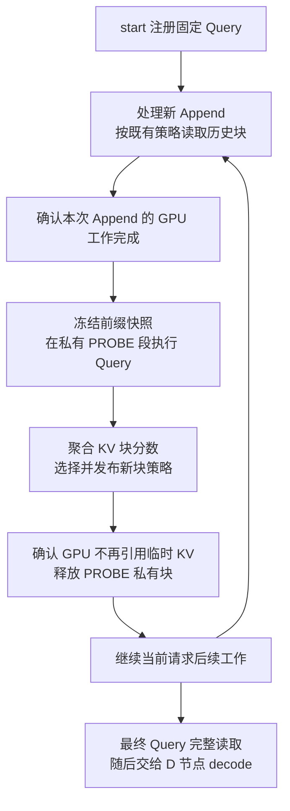

# 基于 Query probe 的 Append KV 块稀疏设计

## 目标与当前决策

在流式 RAG 预填充过程中，每个 Append 知识块完成后，利用提前获得的用户问题执行一次 probe，评估新块中的 KV block（KV 块）。之后处理新 Append 和 Update 时，根据已经确定的策略跳过部分历史 Append KV，减少注意力计算与读取开销。

**实际评分和选择单位是 KV block，Append chunk 是事件、评分触发及预算分配单位。** 本文描述待实现的设计；新增字段、执行阶段和配置名称均为提议，不代表当前代码已经支持。

| 项目 | 当前约定或建议 |
| --- | --- |
| 已确定的选择粒度 | 每个 KV 块 16 token，沿用当前缓存配置 |
| 已确定的第一版评分实验 | 同时记录原始注意力总量和长度校正分数，在每个新 Append 内按固定保留比例选择块 |
| 建议的 Query 入口 | 在现有 `/v1/prompt_stream/start` 中增加 `probe_query` 字段 |
| 建议的 probe 上下文 | 固定模板与截至本次 Append 的已完成前缀，第一版不纳入 Update |
| 建议的临时 KV 存储 | 独立 `PROBE` 段，读取稳定前缀，完成后释放私有块 |
| 建议的首个评分层 | 最后一个 Transformer attention 层，用作基线；后续对照中间层 |
| 建议的第一版作用范围 | Append 和 Update 的 prefill 使用历史块策略；最终 Query 与 decode 完整读取有效 KV |
| 建议的边界处理 | 跨 chunk、跨模板边界或未填满的 KV 块保留，不参与可淘汰块预算 |
| 实验规模 | 沿用当前模型、上下文长度和数据规模，记录 probe 带来的计算及显存开销 |

上一版设想最终 Query 也使用稀疏策略。本轮建议先采用上表的作用范围，将最终 Query 稀疏和 decode 稀疏分别作为后续实验选项。选择算法和评分层的优劣仍需通过实验判断。

## 对象与系统现状

| 符号或对象 | 含义 |
| --- | --- |
| $A_i$ | 第 $i$ 个非空 Append 事件对应的知识块，可被调度器拆成多次 prefill |
| $B_b$ | 一个物理缓存页对应的逻辑 KV 块，通常含 16 个有效 token |
| $Q$ | 提前注册的问题后缀，包含与正式 finish 一致的模板边界 |
| $S_i$ | 为 $A_i$ 确定的保留块集合及保护块信息 |
| $\rho$ | 每个 Append 内可选择块的保留比例，实验参数 |
| Probe attempt | 对某个 Append 快照的一次临时 Query 执行，具有独立标识和进度 |

**策略绑定在被读取的 Append 块上。** $A_i$ 自身的 prefill 使用历史 $S_j$，其中 $j<i$；$A_i$ 完成后产生的 $S_i$ 影响后续读取，不追溯修改已经计算的 KV。

当前代码提供了以下基础：

- [REST 协议](../vllm/entrypoints/serve/prompt_stream/protocol.py) 已有 start、event、finish、abort 路径。start 传固定模板，最终问题通过 finish 的 `prompt_finished` 事件传入。
- [请求状态与执行视图](../vllm/v1/request.py) 已有 `PREFIX_APPEND`、`UPDATE`、`QUESTION` 三种执行阶段，以及两个物理 KV 段。`PREFIX_APPEND` 存模板和 Append；`UPDATE` 存更新快照和最终问题。
- [KV manager](../vllm/v1/core/kv_cache_manager.py) 根据执行视图分别决定读取哪些段、向哪个段分配和写入 KV。
- 现有 masked padding 将整个 `PREFIX_APPEND` 的尾部对齐到缓存块边界，再拼接 `UPDATE`。它表达一个尾部 padding 区间，**没有为每个 Append 单独插入永久空洞**。
- [Triton attention](../vllm/v1/attention/backends/triton_attn.py) 已接收 padding 元数据，但还没有本方案的稀疏块选择和 probe 评分返回接口。

## 用户 Query 的入口和生命周期

### 通过现有 start 注册

建议在 `PromptStreamStartRequest` 增加可选字符串字段 `probe_query`，由 P 节点分词后，经 `EngineClient`、`AsyncLLM`、`EngineCoreRequest` 传入长期 `Request`。Query 必须在首次 Append 被处理前注册。

第一版无须新增独立 REST endpoint。服务端在 Append 完成时自动触发 probe，客户端继续发送普通 Append / Update 事件。若以后需要问题晚到或中途修改，再设计带版本的 Query 更新事件及历史 KV 重建规则。

`probe_query` 的协议语义建议直接定义为：**与本请求最终 `finish.event.text` 相同的完整问题后缀**。当前 replay 的 [prompt.py](scripts/replay/common/prompt.py) 已生成 `finish_text`，其中包含问题和模板后缀，可以在 start 时提前发送这段文本。

- 字段允许省略以兼容旧请求；显式启用 probe 稀疏而未提供 Query 时，应在 start 阶段报错。
- 使用服务端与 finish 一致的分词规则，避免重复添加特殊 token。token ID 和有效评分位置保存在服务端，客户端继续传文本。
- 提前注册只保存元数据，不把问题插到正式 Append 前面，不触发生成，也不提前结束输入流。
- 第一版可以对整个问题后缀的有效 token 聚合，明确记录该口径。仅聚合问题正文的实验需提供服务端校验过的 token 范围，不能假设模板后缀没有影响。
- Query 字段与稀疏配置属于请求控制参数，须与 `sampling_params` 分开处理。

### 请求级生命周期

| 时机 | Query 状态与处理 |
| --- | --- |
| start | 保存规范化 token IDs、内容摘要和初始版本，保持正式 prompt 仍为固定模板 |
| Append 完成 | 引用已注册 Query 创建内部 probe attempt，冻结本次前缀、配置和策略版本 |
| probe 执行中 | 保存临时执行进度和评分累加状态，不改正式问题进度 |
| probe 完成 | 发布 $S_i$，清理临时 Query KV；保留 Query token IDs 供下一次使用 |
| finish | 校验正式问题与注册后缀的 token IDs 一致，按原流程入队唯一的正式 `QUESTION` work |
| abort 或请求结束 | 清理 Query 元数据、未完成 probe、评分状态和私有 KV |

第一版对 finish 中问题不一致的情况，在入队前明确拒绝。直接更换 Query 后只让最终阶段恢复完整读取，不能撤销此前基于旧问题计算出的稀疏 Append KV；要支持问题变化，需要重新建立对应请求上下文。

代理也需要同步处理字段：[proxy_server.py](scripts/server/proxy_server.py) 的 `_build_prefill_start_request()` 应向 P 传递 Query，`_build_decode_base_request()` 应移除 probe 专用字段，避免把它们当作普通生成参数发给 D。Stable KV proxy 共用这部分辅助函数，也需覆盖验证。

## Append 与 probe 的调度顺序

建议增加内部 `PROBE` 执行阶段，并将其视为 Append 完成后的依赖工作。它不产生外部 source 事件、不推进 Append 内容版本，也不借用正式 `QUESTION` 阶段。

每个非空 Append 事件完整执行后触发一次 probe。一个 Append 被 scheduler 切成多个 prefill 批次时，只在最后一个批次完成后触发；start 的模板 bootstrap、空 Append 和事件重试不额外触发。

第一版按同一请求串行处理 Append、其 probe 和策略发布。后续事件可以接收并排队，但依赖新块策略的下一项 work 要等策略就绪。probe 不应越过更早已经入队的 Update 去处理未来 Append，也不改变不同请求之间现有的调度优先级。

需要区分两种完成状态：

- **KV 已完成：** Append 的真实 KV 已由 GPU 计算完，可以按现有规则发布稳定完整块。
- **策略已就绪：** probe 返回分数、完成选择并发布 $S_i$，后续依赖该策略的 work 才能执行。

不能只看乐观推进的 `num_computed_tokens` 判断 GPU 已完成。现有代码有 Update 在途计数，新增流程还需覆盖 Append / probe 的完成确认，防止下一次 Append 覆写尾部 padding 时，旧 probe 仍在读取该块。

probe 消耗真实 scheduler token 预算，并参与资源竞争。存在待执行 probe 的请求不能被判定为仅等待外部事件的 dormant 请求；等待 GPU 结果时也不能反复创建同一 probe。没有可执行工作且临时资源已清理后，再使用原 dormant 流程。

## 临时 Query KV 的存储与释放

### 推荐独立 PROBE 段

第一版 probe 只读取固定模板和本次已完成的 Append 前缀。设真实前缀长度为 $L_i$，对齐后的物理长度为：

$$
P_i=16\left\lceil\frac{L_i}{16}\right\rceil
$$

本次执行视图由已冻结的 `PREFIX_APPEND` 物理视图和私有 `PROBE` 段拼接：

- `required_segments` 为 `PREFIX_APPEND + PROBE`，`write_segment` 为 `PROBE`。
- 前缀 $[L_i,P_i)$ 使用已有 padding 屏蔽逻辑；probe 从下一物理块开始写入。
- Query 的物理位置从 $P_i$ 开始，RoPE 的语义位置从 $L_i$ 开始，继续使用现有物理位置与语义位置分离机制。
- probe 的段内进度独立计数；执行视图的全局已计算位置由 $P_i$ 加上该进度构成。
- Query 中后面的 token 和后续层仍需要相应 KV，因此 probe 跨 scheduler step 时必须保留私有段，不能每一步都清空。

这样既能复用已完成的前缀 KV，也不需要把 Query 写进正式 `PREFIX_APPEND` 或 `UPDATE`。一次 probe 完成后，只释放它私有的块；下次 probe 重新使用当前前缀并计算新的 Query KV。

私有段应绑定 request、probe attempt 和缓存代次。共享读取的前缀块需要引用保护或等效生命周期保证；释放私有块不能误减共享前缀的所有权。

### 为什么不把 Query 永久改成 padding

| 方案 | 分析 |
| --- | --- |
| 写入正式 Append 后，留下 Query 长度的 padding | 多次 probe 会累积内部空洞，增加物理长度，并要求多段 padding、位置映射和传输协议一起扩展 |
| 写入正式尾部，再回滚长度和释放尾部块 | 需要同时回滚 worker 视图、计算进度、块引用、传输状态；尾部共享块还可能需要备份或写时复制 |
| 私有 PROBE 段 | 复用已有的前缀尾部对齐，只对临时 Query 单独分配和释放，适合作为初始实现 |

Query 与 Append 的执行可以在依赖允许时融合优化，但其写入所有权仍应分开。第一版先分成两个 work，避免把分配、回滚和评分完成时序耦合到一次 forward 中。

### 释放清单与传输清单必须分开

当前 `get_prompt_stream_segment_keys()` 同时被请求释放和最终 `get_prompt_stream_blocks()` 导出使用。新增 `PROBE` 后，不能直接把第三个 key 加进这份共用列表。

- **所有权与清理清单：** 包含正式段、当前 probe 私有段及其待释放资源。
- **本轮执行清单：** 根据 execution view 选择，例如 probe 的 `PREFIX_APPEND + PROBE`。
- **最终 P/D 传输清单：** 继续只包含 `PREFIX_APPEND + UPDATE`，其中包含正式 Question KV。

probe KV 不参与前缀缓存共享、早期稳定 KV push 或最终传输。回包、abort、抢占、异常路径都必须等 GPU 不再使用对应私有块后再归还 block pool；发起清理不等于 GPU 引用已经结束。

### 如果以后需要让 probe 读取 Update

这会将评分绑定到具体 Update 快照，必须冻结已提交的 Update 版本和 Append epoch。不能用刚到达但尚未完成的 Update 内容冒充可用 KV。

`UPDATE` 的尾部可能没有对齐。直接把 `UPDATE + PROBE` 的 block table 拼起来，会把 Query 放到错误的物理偏移。可选实现包括复制 Update 的最后一个部分块到私有区后追加 Query，或增加 Update 尾部对齐并扩展多 padding 区间表示。第一版选择不纳入 Update，从而复用现有单区间布局。

## Append chunk 边界与 KV 块归属

**chunk 边界需要显式记录，不能直接忽略。** Append 事件连续写入 `PREFIX_APPEND`，相邻 chunk 可能共享一个物理 KV 块；模板与首个 Append 也可能共享块。

服务端在事件分词完成后记录每个 $A_i$ 的真实 token 半开区间，以及 source ID、chunk ID、sequence、内容摘要和 Append epoch。范围使用实际 token 日志坐标，不能按字符数推测。

第一版将 KV 块分成两类：

- **可选择块：** 16 个真实 token 全部属于同一个已完成的 Append，且不包含模板或 padding。
- **保护块：** 跨模板或 Append 边界、包含当前部分尾块，或归属尚不确定的块。后续读取时保留有效 token，padding 继续屏蔽。

例如，假设 $A_1$ 从块边界开始且有 30 token。它占满第一个 16-token 块，并占第二块的前 14 个位置；随后 $A_2$ 会接着填入第二块的剩余位置。第二块属于两个 chunk，应保持可见，不能因为 $A_1$ 的策略而把 $A_2$ 的开头一起跳过。

这里不需要给每个 Append 增加永久对齐 padding。当前前缀的临时尾部 padding 仍可被未来真实 Append 覆盖；与它共享的尾块已经被保护，因此也不需要对该部分的旧评分进行复用。

跨边界块即使后来填满，也继续按混合归属保护。一个 Append 没有完整独占块时，直接保留其所有有效 KV；可以记录一次无选择收益的 probe，后续再评估跳过这类 probe 的优化。

保护块不计入可淘汰预算，但必须计入实际读取量。例如可选择块保留一半，并不代表整个 Append 恰好跳过一半 token。实验需分别报告保护块、可选择块和最终保留块数量。

## 评分与固定比例选择

### 统计口径

参考 [FusionRAG 的 Query-Guided Selection](https://arxiv.org/html/2601.12904v1#S3.SS2)，第一版可使用最后一个 attention 层的 Query 到上下文信号。我们的 Query probe 会读取当前前缀，与只对问题本身做前向计算的方式有所区别。最后层只是基线，后续应对照中间层。

第一版 probe 对历史 Append 使用已发布策略，对当前待评估 $A_i$ 完整可见。它保持内部 Query 的因果关系，并记录本次实际可见范围。不要在还没有得到评分时先屏蔽当前候选块。

设 $m$ 为参与评分的问题 token 数，$H$ 为 Query head 数，$P_{h,q,t}$ 为选定层的实际 softmax 权重。对新块中的 $B_b$ 记录原始注意力总量：

$$
s_b=\frac{1}{Hm}\sum_{h=1}^{H}\sum_{q=1}^{m}
\sum_{t\in B_b}P_{h,q,t}
$$

再记录相对于均匀注意力的校正分数：

$$
r_b=\frac{1}{Hm}\sum_{h=1}^{H}\sum_{q=1}^{m}
\frac{N_{h,q}}{n_b}\sum_{t\in B_b}P_{h,q,t}
$$

其中 $N_{h,q}$ 是该行真正参与 softmax 的有效 KV 数，包含当行可见的模板、历史 Append、当前 Append 和 Query 前缀，排除 padding、未来 token 及被稀疏屏蔽的位置；$n_b$ 为该块的有效 token 数。可选择块的 $n_b$ 固定为 16。

$r_b$ 用于检查随上下文增长产生的长度偏差。它不消除上下文内容、Query 表示和历史稀疏策略变化的影响，不能作为跨 probe 的绝对相关性保证。第一版不将不同时间的 $r_b$ 放入统一全局阈值进行淘汰。

### 从块分数产生策略

令 $\mathcal E_i$ 为 $A_i$ 的可选择块集合，$\mathcal G_i$ 为与其相关的保护块集合。第一版按原始分数 $s_b$ 做块内 Top-K：

$$
k_i=\left\lceil\rho|\mathcal E_i|\right\rceil,
\qquad
S_i=\mathcal G_i\cup\operatorname{TopK}_{b\in\mathcal E_i}(s_b,k_i)
$$

$\rho$ 由实验配置给出；全保留对应 $\rho=1$。分数并列时按逻辑块编号稳定选择。多个 chunk 共用的保护块在实际执行时去重，选中的 KV 块按原逻辑顺序访问。

第一版将聚合后的选择结果共享给各层和 Query heads，减少元数据和实验变量。分层、分头选择及按块重要性动态调整 $\rho$，作为后续实验。

### 在 worker 中提取分数

[Qwen2 模型路径](../vllm/model_executor/models/qwen2.py) 在 Q/K 投影和 RoPE 后调用 attention。评分应使用该层实际进入 attention 的 Q，以及对应缓存中的 K，并保持 GQA 的 Q-head 到 KV-head 映射。不能用 attention 输出向量代替权重。

只采集最后一层评分，仍需要 Query 的前置模型层产生该层输入，不能把 probe 成本估计成只执行一个层。

当前 Triton 路径没有直接返回完整注意力矩阵。建议先增加独立的评分计算：在选定层按真实可见范围扫描 QK，得到每行归一化量，再归约当前 Append 的块分数。可以使用分块扫描控制显存，不需要保留所有层的完整 attention 矩阵。

如果只额外计算当前 Append 的 QK，需要从原 attention 获取严格对应的全局归一化量。**只在当前 chunk 内做 softmax 会改变分数含义**，不能将其当作实际的全上下文注意力总量。

后续再考虑复用 kernel 的 log-sum-exp 或融合归约。在线 softmax 的中间 tile 权重尚未按最终分母归一化，不能直接累加为最终分数。第一版应先以明确的归一化计算验证结果，再优化重复扫描开销。

## 策略传给后续计算的方式

### 策略状态与元数据

建议在 Request 中保存每个 Append 的逻辑区间、可选择块和保护块、$s_b$、$r_b$、保留集合、Query 版本、评分配置及策略版本。记录 probe 使用的 Append epoch 和历史策略快照，便于复现。

长期策略使用逻辑块编号，不能只保存 block pool 的物理 ID；抢占和恢复后，物理块号可能改变。调度时通过当前 block table 将逻辑选择映射到实际缓存。

一次 work 开始时冻结它使用的策略版本，并经调度输出传到 worker。worker 将当前行所属阶段、允许读取的逻辑块和 padding 信息一起传给 attention backend。动态 batch 的插入、删除和重排都要同步这些元数据。

建议的数据传递路径为：

1. Request 保存 Query、Append 范围、已发布策略和 probe 状态。
2. `SchedulerOutput` 及请求刷新数据携带当前执行类型、快照与选择信息。
3. `GPUModelRunner` 和 input batch 建立与当前请求行对应的 attention 元数据。
4. attention 层执行块稀疏，或为 probe 归约分数。
5. `ModelRunnerOutput` 通过专用结果字段返回 probe 标识和块分数；scheduler 校验版本后发布策略。

这些评分结果不应借用生成 token、logprobs 或对外 SSE 文本通道。probe 不进入正式采样、停止判断和请求完成流程，也不推进正式 `question_num_computed_tokens`。

### 推荐的第一版作用范围

| 阶段 | 对历史 Append 的读取 | 其他约束 |
| --- | --- | --- |
| 新 Append prefill | 使用已经发布的 $S_j$ | 当前 Append 内部完整因果注意力，模板与保护块保留 |
| Query probe | 历史块使用 $S_j$，当前待评分 Append 完整读取 | 读取冻结前缀，Query KV 写入私有段 |
| Update prefill 或重算 | 使用当前 work 冻结的历史策略 | Update 内部保留正常因果关系，沿用原版本和 LCP 规则 |
| 最终 Query prefill | 完整读取所有有效 Append 和最终 Update KV | 重新计算正式 Query，继续屏蔽布局 padding |
| D 节点 decode | 完整读取已传输的有效 KV | 使用原有缓存和布局信息，无需读取选择集合 |

这个范围优先加速反复发生的知识块计算，同时允许最终问题和生成过程读取所有保留在缓存中的信息。由于没有删除未选中的 KV，最终阶段恢复完整读取可以通过选择完整访问路径实现。

**完整读取不会把历史 KV 恢复成完整注意力 prefill 的结果。** 后来的 Append 和 Update 已经在稀疏历史依赖下产生了表示；最终 Query 能看到这些表示的全部位置，但无法自动补回此前省略的跨块计算。质量仍需要端到端评估。

### 最终 Query 和 decode 稀疏作为独立实验

建议配置按阶段指定作用范围，而不是一个全局布尔开关。依次比较只稀疏 Append、稀疏 Append 与 Update、再加入最终 Query、最后加入 decode。

如果在 D 节点启用 decode 稀疏，最终传输元数据还需携带逻辑块选择、保护范围、策略版本与布局标识。D 必须按自己的 block table 映射，不能使用 P 的物理块 ID。P/D 应校验策略兼容性，并明确接收后逐 token decode 的可见规则。

第一版 D 完整读取，因此传输仍需包含全部正式 KV；注意力计算节省不等于显存容量或 KV 传输量节省。probe 元数据仅作为实验记录保留，临时 KV 始终不传输。

## Attention 后端的实现边界

建议先在当前 `TRITON_ATTN` 路径上完成接入，继续使用现有分段、padding 与语义位置机制。FlashInfer 的稀疏接口可以作为算子实验或后续替代后端，需要另行对接分页布局。

不要通过删减正式 block table 来实现稀疏读取。完整 block table 仍负责地址映射、KV 写入及最终完整读取；另外提供只读选择索引或位图，让 kernel 保持原逻辑位置遍历允许的 KV 块。

当前 [Triton kernel](../vllm/v1/attention/ops/triton_unified_attention.py) 按连续 tile 循环计算 QK 和 PV。实现需要让不选中的块实际绕过相应读取与计算，而不仅在算完之后将分数置为负无穷。

16-token KV 块与 kernel 的 tile 大小不一定相同。首个正确性版本可以先验证访问 mask；性能版本需要支持稀疏块遍历，或在 tile 聚合时处理部分选中的块，并按真实执行量报告收益。因果关系、padding、保护范围和阶段策略必须同时生效。

## 并发、恢复与资源约束

- **快照和回包校验：** 每次 probe 冻结 Query 版本、Append epoch、历史策略版本和 attempt 标识。迟到或已取消的 GPU 结果不得发布到新状态。
- **同请求写入隔离：** probe 在途时，后续 Append 不能覆写它读取的前缀尾块。第一版串行执行；其他请求仍可正常调度。
- **抢占恢复：** 私有 probe KV 可以丢弃并重试，但须先等待在途访问结束。保存逻辑 Query、Append 边界和已发布策略，清除失效的物理映射。
- **历史 KV 重建：** 恢复已完成 Append 时，必须按原事件边界和原策略重建其历史读取关系。不能将所有历史 Append 合并成一次采用当前 mask 的 prefill，否则会改变原本的计算语义。已完成策略不重复生成；未完成 probe 在前缀恢复后重试。
- **策略与 Update 复用：** 第一版发布后冻结旧 $S_i$。若以后修改已有策略，依赖它的 Update KV 和 LCP 复用也需重新校验，不能只比较文本相同就复用。
- **资源预算：** 长度校验分别覆盖正式 prompt 和 $P_i+|Q|$ 的 probe 物理视图；临时 Query KV 按每个并发 probe 单独占用块，并计入准入和峰值显存。
- **失败策略：** 评分失败或资源不足时可显式配置为中止实验请求，或将当前新块标记为全保留并记录降级原因。后者只改变该块的后续策略，不宣称整条请求已经恢复成 dense prefill。
- **缓存与传输隔离：** 保持 prompt-stream 缓存不进入普通前缀缓存共享。稳定 KV push 只发布已完成的正式块，沿用其代次与恢复规则，避免把旧代次传输结果和新建 KV 混用。

## 需要修改的模块

| 模块 | 计划改动 |
| --- | --- |
| [REST 协议与 serving](../vllm/entrypoints/serve/prompt_stream/serving.py) | Query 字段、服务端分词、finish 一致性、长度镜像与 probe 预算校验 |
| [Engine 协议](../vllm/engine/protocol.py)、[AsyncLLM](../vllm/v1/engine/async_llm.py)、[EngineCoreRequest](../vllm/v1/engine/__init__.py) | 将 Query 与稀疏配置传入长期请求，不混入采样参数 |
| [Request](../vllm/v1/request.py) | Append token 范围、Query 生命周期、内部 PROBE work 与 view、策略版本和恢复规则 |
| [Scheduler](../vllm/v1/core/sched/scheduler.py) | Append 完成确认、probe 依赖、资源预算、在途保护、结果发布和 dormant 判断 |
| [KV manager](../vllm/v1/core/kv_cache_manager.py) | 私有段分配、释放及所有权；拆分清理、执行和导出清单 |
| [调度输出](../vllm/v1/core/sched/output.py)、[GPUModelRunner](../vllm/v1/worker/gpu_model_runner.py)、[input batch](../vllm/v1/worker/gpu_input_batch.py) | 阶段和稀疏元数据传递、batch 重排、probe 位置及不采样路径 |
| [ModelRunnerOutput](../vllm/v1/outputs.py) | 专用 probe 结果及 attempt 标识，适配异步回包路径 |
| [Triton backend](../vllm/v1/attention/backends/triton_attn.py) 与 kernel | 评分归约、块选择元数据、真正跳过 KV 块计算 |
| [普通 proxy](scripts/server/proxy_server.py)、[Stable KV proxy](scripts/server/stable_kv_proxy.py)、[replay](scripts/replay/common/prompt.py) | 提前发送同一问题后缀、正确过滤控制字段、输出实验统计 |

初始实现以当前单 GPU、TP=1 的 Qwen 路径验证。扩展到 TP 时需正确合并分片 Query heads 的分数，不能把单个 rank 的局部均值直接当作全模型均值。

## 实施顺序与验证

1. **先实现只观察的 probe。** 贯通 Query 字段、内部阶段、私有 KV 和块分数；所有块保持可见，验证临时执行不会污染正式 prompt、输出和传输。
2. **验证固定比例选择。** 记录原始分数与校正分数，构造保护块和 $S_i$；以完整 attention 加显式 mask 验证语义，再接入真正的块稀疏计算。
3. **启用 Append 与 Update 稀疏。** 完成事件边界、抢占恢复、Update 复用和 P/D 路径验证，再进行端到端质量与性能实验。
4. **扩展作用范围和评分方法。** 对照最终 Query / decode 稀疏、中间层评分以及动态预算，分别记录新增质量变化与开销。

关键正确性检查包括：

- 全保留模式下，加入 probe 后的正式 token 布局与输出在相同后端允许的数值容差内对齐基线，没有多余问题副本或永久空洞。
- Append 长度为 15、16、17 token 等边界情况，以及模板与 Append、相邻 Append 共页时，保护块和有效位置正确。
- 一个 Append 拆成多次 prefill、Query 跨 step、事件重试和空事件时，probe 触发与发布次数正确。
- probe 在途发生 abort、抢占、后续事件入队时，没有块提前释放、迟到结果覆盖或临时段泄漏。
- 稀疏 kernel 与相同可见范围的参考 attention 一致，包含 padding、GQA、因果关系和 batch 重排情况。
- finish 问题不一致时在正式入队前拒绝；P/D 导出没有 probe KV，D 完整读取包含全部正式缓存。

实验记录至少包含数据集 EM / F1、各阶段耗时、TTFT、吞吐、probe 次数与执行 token 数、评分扫描开销、策略构造耗时、临时 KV 峰值、保护块数量和实际跳过块数量。probe 的临时释放单独统计，不混入现有 Update 失效 token 指标。

**端到端收益必须覆盖 probe、额外评分扫描、策略同步与调度开销。** 需要同时使用无 probe 的完整注意力基线、全保留但执行 probe 的对照，以及相同预算的随机或固定块选择，区分新增成本、评分价值和稀疏 kernel 本身的收益。
