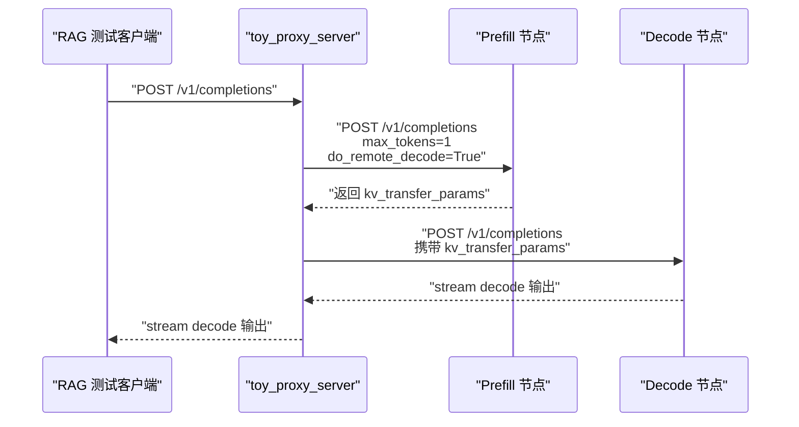
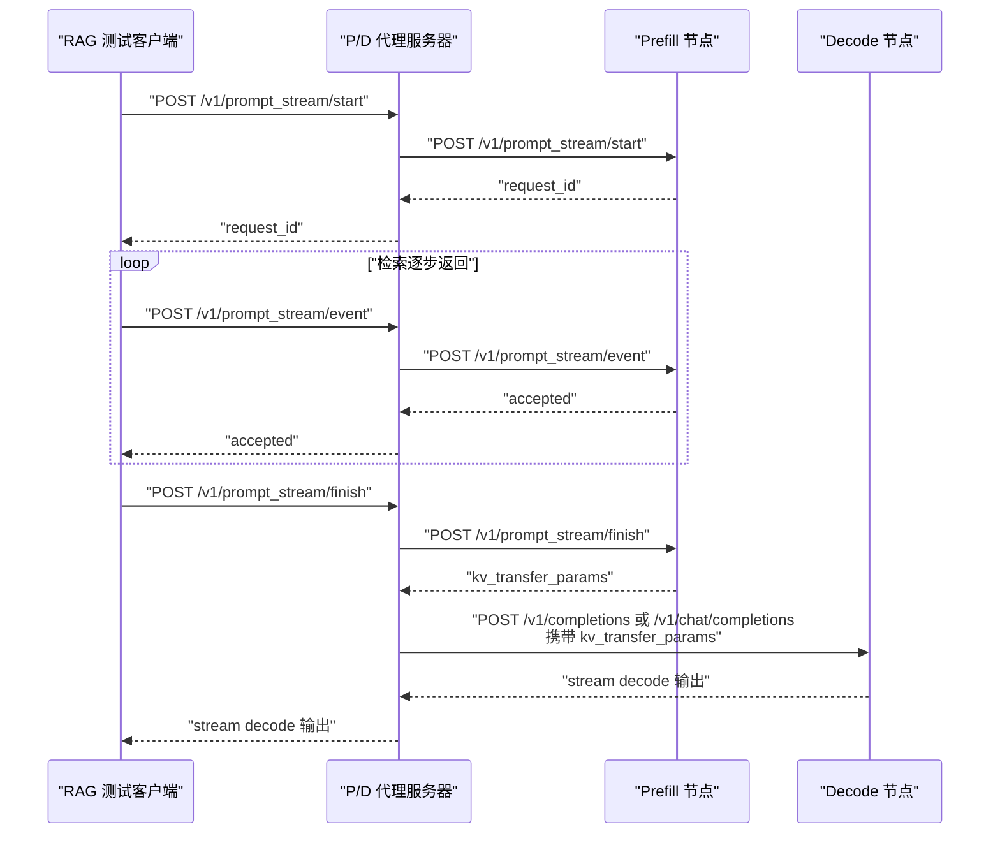

# 流式 Prefill 的 RESTFUL 接口设计

这份文档先只设计接口和链路，不直接修改代码。目标是让 RAG 测试请求先发到 **P/D 分离代理服务器**，由代理服务器把 Append、Update 和最终用户问题转发给 P 节点，并在 prompt 封口后把 KV transfer 信息交给 D 节点继续 decode。

当前代码里已经有两个相关入口：

- `tests/v1/kv_connector/nixl_integration/toy_proxy_server.py`：测试用 P/D proxy。它现在只支持一次性 `/v1/completions` 和 `/v1/chat/completions` 请求。
- `vllm/entrypoints/openai/api_server.py`：OpenAI-compatible server 的主入口。它通过 `build_app()` 注册各类 router，包括 completions、chat completions、disagg 等。

当前流式 prefill 的核心矛盾是：**Append / Update 事件不是生成请求，不应该等待 completion response；它们应该是 ack 型状态更新接口。** 因此不能直接把所有事件都塞进现有 `/v1/completions`。

## 当前 P/D proxy 的现有语义

`toy_proxy_server.py` 当前流程是一次性 P/D 请求：



这个模型假设 P 请求会返回一次 completion response，并且 proxy 可以从 response 中拿到 `kv_transfer_params`。流式 prefill 不符合这个模型，因为 Append / Update 事件应该只是更新 P 节点上的长期 `Request` 状态。

## 新的会话模型

流式 prefill 需要把一个 RAG 请求拆成三个阶段：

- **Start**：创建 P 节点上的长期请求，保存固定 prefix/template。
- **Event**：多次提交 Append / Update / Source Finished 事件，只返回 ack。
- **Finish**：提交最终用户问题，P 节点完成最后 prefill，产生 `kv_transfer_params`，然后 D 节点继续 decode。

整体流程如下：



这个设计保持一个原则：**P 节点负责流式 prefill 状态，D 节点只接收最终 KV 后继续 decode。**

## 代理服务器 RESTFUL 设计

代理服务器是 RAG 测试客户端唯一直接访问的入口。测试代码不直接访问 P 节点或 D 节点。

### 会话状态

`toy_proxy_server.py` 需要新增一个会话表：

```python
app.state.prompt_stream_sessions = {
    request_id: {
        "prefill_client": prefill_client_info,
        "decode_client": decode_client_info,
        "api": "/completions" | "/chat/completions",
        "base_request": {...},
    }
}
```

这个会话表的作用是：

- 固定一个请求对应的 P 节点，后续所有 Append / Update 都必须发到同一个 P。
- 固定一个请求对应的 D 节点，finish 后把 KV 交给同一个 D。
- 保存原始生成请求参数，例如 `model`、采样参数、是否 chat、stream 设置等。
- 避免每个事件都重新 round-robin 到不同 prefiller。

### `POST /v1/prompt_stream/start`

用途：创建一个流式 prefill 会话，并在 P 节点创建长期 Request。

请求示例：

```json
{
  "api": "completions",
  "model": "local-completions",
  "prompt": "通用模板或 system prefix",
  "stream": true,
  "max_tokens": 128,
  "temperature": 0,
  "request_id": "optional-user-request-id"
}
```

字段说明：

| 字段 | 含义 |
| --- | --- |
| `api` | 使用 `completions` 还是 `chat/completions`。MVP 建议先只支持 `completions`。 |
| `model` | 传给 vLLM 的模型名。 |
| `prompt` | 固定 prefix/template。Start 阶段可以继续使用普通 prompt 文本，由 P 节点走现有输入处理链路完成 tokenize。 |
| `stream` | finish 后 D 节点是否 streaming 返回。 |
| `max_tokens` | D 节点 decode 的最大 token 数；P 节点 start 阶段不会真正 decode。 |
| `request_id` | 可选。没有提供时由 proxy 生成稳定 request id。 |

返回示例：

```json
{
  "request_id": "ps-8b9c...",
  "status": "started"
}
```

代理服务器行为：

- 生成或读取稳定 `request_id`。
- round-robin 选择一个 P 节点和一个 D 节点。
- 保存会话表。
- 转发到 P 节点的 `/v1/prompt_stream/start`。
- 不联系 D 节点。

### `POST /v1/prompt_stream/event`

用途：提交 Append、Update 或 Source Finished 事件。这个接口只返回 ack，不返回模型输出。

请求示例：

```json
{
  "request_id": "ps-8b9c...",
  "event": {
    "source_id": "retriever_0",
    "event_type": "update",
    "source_type": "update",
    "chunk_id": "retriever_0_v2",
    "version": 2,
    "sequence_no": 2,
    "text": "检索到的一段文本。",
    "token_ids": null,
    "arrival_time": 123.45
  }
}
```

也可以直接传 token ids，便于测试精确控制 LCP：

```json
{
  "request_id": "ps-8b9c...",
  "event": {
    "source_id": "retriever_0",
    "event_type": "update",
    "source_type": "update",
    "chunk_id": "retriever_0_v2",
    "version": 2,
    "sequence_no": 2,
    "text": null,
    "token_ids": [101, 102, 103],
    "arrival_time": 123.45
  }
}
```

代理服务器行为：

- 根据 `request_id` 查找会话。
- 补齐 `event.request_id`，确保和外层 `request_id` 一致。
- 把事件转发到会话绑定的 P 节点。
- 不在 proxy 层做 tokenization；文本到 token ids 的转换由 P 节点完成，避免 proxy 和 P 使用不同 tokenizer。
- 返回 P 节点 ack。
- 不联系 D 节点。

返回示例：

```json
{
  "request_id": "ps-8b9c...",
  "status": "accepted",
  "event_type": "update"
}
```

### `POST /v1/prompt_stream/finish`

用途：提交最终用户问题，触发 P 节点完成最后 prefill，并把返回的 `kv_transfer_params` 交给 D 节点继续 decode。

请求示例：

```json
{
  "request_id": "ps-8b9c...",
  "event": {
    "source_id": "final_question",
    "event_type": "prompt_finished",
    "source_type": null,
    "chunk_id": "final_question_0",
    "version": 0,
    "sequence_no": 0,
    "text": "用户最终问题是什么？",
    "token_ids": null,
    "arrival_time": 130.0
  }
}
```

测试也可以直接传最终用户问题的 token ids：

```json
{
  "request_id": "ps-8b9c...",
  "event": {
    "source_id": "final_question",
    "event_type": "prompt_finished",
    "source_type": null,
    "chunk_id": "final_question_0",
    "version": 0,
    "sequence_no": 0,
    "text": null,
    "token_ids": [2001, 2002, 2003],
    "arrival_time": 130.0
  }
}
```

代理服务器行为：

- 根据 `request_id` 查找会话。
- 转发 `PROMPT_FINISHED` 到绑定的 P 节点。
- P 节点完成最终用户问题 prefill，并返回 `kv_transfer_params`。
- proxy 把 `kv_transfer_params` 写回最初保存的 `base_request`。
- proxy 调用绑定的 D 节点 `/v1/completions` 或 `/v1/chat/completions`。
- proxy 把 D 节点输出返回给 RAG 测试客户端。

返回形式：

- 如果 `base_request.stream == true`，返回 streaming response。
- 如果 `base_request.stream == false`，返回普通 JSON response。

### `POST /v1/prompt_stream/abort`

用途：取消一个还没 finish 的流式 prefill 请求。

请求示例：

```json
{
  "request_id": "ps-8b9c..."
}
```

行为：

- proxy 转发 abort 给绑定的 P 节点。
- 如果已经发给 D，也要转发 abort 给 D 节点。
- 清理 proxy 会话表。

MVP 可以先不实现，但接口需要预留，否则测试失败后 P 侧 KV 可能泄漏。

## Stream2LLM 的参考结论

Stream2LLM 的实验脚本没有走 RESTFUL，而是直接创建 `EngineCoreClient`，手工构造 `EngineCoreRequest` 后送进 EngineCore。它的关键路径是：

```text
experiments/crawler/stream_client.py
  -> make_stream_request() / append_stream_request() / update_stream_request()
  -> EngineCoreRequest
  -> EngineCoreClient.add_request_async() 或 create_stream_request_async()
  -> EngineCore.add_request()
```

它的 client 侧维护了两个东西：

- **输入队列**：后续 Append / Update 通过同一个 queue 持续送入 EngineCore。
- **输出队列**：start 时按 `request_id` 注册，finish 后从这个队列等待第一个 decode output。

EngineCore 侧的逻辑是：

```text
如果 request_id 已经在 scheduler 中：
    把新 EngineCoreRequest 当作流式 prompt 事件
    对 existing Request 做 append 或 update
    不创建新的长期 Request
否则：
    创建新的 Request 并加入 scheduler
```

我们不想让 RAG 测试直接操作 `EngineCoreClient`，但可以复用这个结构思想：

- RESTFUL proxy 的会话表相当于 Stream2LLM 的输入 queue。
- P 节点 serving 层的 session state 相当于 Stream2LLM 的输出 queue 注册。
- `/event` 只负责把事件送进 EngineCore，不应该创建新的输出 collector。
- `/finish` 送入 `PROMPT_FINISHED` 后，从 start 阶段注册的 collector 等待 `kv_transfer_params`。

这比“每个事件都调用普通 generate”更稳定，也更接近 Stream2LLM 已经验证过的控制流。

## P 节点 RESTFUL 设计

P 节点接口应该挂在 OpenAI-compatible server 上，而不是旧的 `vllm/entrypoints/api_server.py` demo server。

推荐新增一个独立 router，例如：

```text
vllm/entrypoints/serve/prompt_stream/api_router.py
vllm/entrypoints/serve/prompt_stream/protocol.py
vllm/entrypoints/serve/prompt_stream/serving.py
```

然后在 `vllm/entrypoints/openai/api_server.py` 的 `build_app()` 中注册：

```python
from vllm.entrypoints.serve.prompt_stream.api_router import (
    attach_router as attach_prompt_stream_router,
)

attach_prompt_stream_router(app)
```

这样做的好处是：

- 不把实验逻辑塞进 OpenAI server 主文件。
- 保持和现有 `serve/disagg/api_router.py` 类似的组织方式。
- 后续可以独立删除或隐藏这个实验接口。

### `POST /v1/prompt_stream/start`

P 节点收到 start 后，需要创建长期 Request，并注册后续 finish 阶段要读取的输出 collector，但 HTTP handler 本身只返回 ack。

推荐第一版采用类似 Stream2LLM 的控制流：

1. P 节点 route 对 start 请求做 tokenize，得到 prefix/template 的 token ids。
2. 构造普通的初始 `EngineCoreRequest`，其中 `prompt_stream_event=None`。
3. 调用一个新的 ack 型 engine client 方法，例如 `add_prompt_stream_request()`。
4. 这个方法内部需要完成两件事：
   - 把初始 `EngineCoreRequest` 送入 EngineCore。
   - 为该 `request_id` 注册 output collector，并保存在 P 节点 session state 中。
5. start 接口立即返回 `started`，不等待模型输出。

这里不要简单地调用普通 `/v1/completions` 或普通 `generate()` 后丢掉 generator。原因是输出 collector 的生命周期必须被显式保存，否则 finish 阶段无法可靠拿到 `kv_transfer_params`，也可能造成未消费队列堆积。

需要补的工程接口更像：

```python
collector = await engine_client.add_prompt_stream_request(
    request_id=request_id,
    request=engine_core_request,
    params=sampling_params,
)
app.state.prompt_stream_sessions[request_id].collector = collector
```

如果复用现有 V1 `AsyncLLM.add_request()`，它本身已经能创建 `RequestOutputCollector`，但 `EngineClient` protocol 目前没有暴露这个方法。因此更干净的做法是给 protocol 增加专门的 prompt stream 方法，而不是在 router 中依赖具体 `AsyncLLM` 类型。

### `POST /v1/prompt_stream/event`

P 节点收到 event 后，构造一个只携带 `prompt_stream_event` 的 `EngineCoreRequest`：

```python
EngineCoreRequest(
    request_id=request_id,
    prompt_token_ids=[],
    sampling_params=sampling_params,
    pooling_params=None,
    arrival_time=event.arrival_time,
    prompt_stream_event=prompt_stream_event,
)
```

这个请求进入 EngineCore 后的链路是：

```text
EngineCoreRequest(prompt_stream_event=event)
  -> EngineCore.preprocess_add_request()
  -> Request.from_engine_core_request()
  -> Request(prompt_stream_event=event)
  -> Scheduler.add_request()
  -> existing.apply_prompt_stream_event(event)
```

如果 `request_id` 已经存在，scheduler 会把这个临时 Request 当作事件载体，把事件应用到长期 Request 上。

注意点：

- 这个接口应该立即返回 ack，不等待模型输出。
- 对 Append / Update 事件，`sampling_params` 只需要满足构造 Request 的最低要求，不应该改变原始采样参数。
- `prompt_token_ids` 对事件请求没有业务意义，但当前 `Request` 构造需要 prompt token 字段。MVP 可以传空 list。
- event 不能再注册新的 output collector；collector 应该只在 start 阶段注册一次。
- 因此 event 更适合走一个 core-only 方法，例如 `engine_client.add_prompt_stream_event(request)`，内部只把 `EngineCoreRequest` 送到 EngineCore。
- 更干净的长期方案是给 `EngineCoreRequest` 增加更明确的 request type，例如 `PROMPT_STREAM_EVENT`，但第一版可以复用 `ADD`，依赖 scheduler 的 duplicate `request_id` 分支。

### `POST /v1/prompt_stream/finish`

P 节点收到 finish 后，需要先把 `PROMPT_FINISHED` 事件送进 EngineCore，然后等待 P 节点完成最后 prefill 并返回 `kv_transfer_params`。

这里和普通 event 的区别是：finish 需要一个 response，不能只 ack。

推荐行为：

- 构造 `EngineCoreRequest(prompt_stream_event=prompt_finished_event)`。
- 通过 core-only 方法把 `PROMPT_FINISHED` 事件送入 EngineCore。
- 从 start 阶段保存的 output collector 中等待首个 output。
- 从 output 中提取 `kv_transfer_params`。
- 返回给 proxy。

这个设计对应 Stream2LLM 的 `create_stream_request_async()`：start 阶段注册输出队列，后续事件只进输入队列，finish 后再从同一个输出队列拿首个 decode output。

返回示例：

```json
{
  "request_id": "ps-8b9c...",
  "status": "prefill_finished",
  "kv_transfer_params": {
    "do_remote_prefill": true,
    "do_remote_decode": false,
    "remote_block_ids": [[0, 1, 2]],
    "remote_num_tokens": 128,
    "remote_engine_id": "...",
    "remote_host": "...",
    "remote_port": 8100
  }
}
```

这里还有一个需要后续验证的点：现有 connector 是在 request finished / first decode output 路径上产出 `kv_transfer_params`。实现时要确认 start 阶段保存的 collector 能收到 finish 后的首个 output，并且该 output 中包含 `kv_transfer_params`。如果不能，需要在 connector 或 output processor 路径上补一层显式通知。

## D 节点 RESTFUL 适配

D 节点暂时不需要新增 prompt stream API。

D 节点继续使用现有接口：

```text
POST /v1/completions
POST /v1/chat/completions
```

proxy 在调用 D 节点前，把 P 返回的 `kv_transfer_params` 写入请求体：

```json
{
  "model": "local-completions",
  "prompt": "...",
  "stream": true,
  "max_tokens": 128,
  "kv_transfer_params": {
    "do_remote_prefill": true,
    "do_remote_decode": false,
    "remote_block_ids": [[...]],
    "remote_num_tokens": 128,
    "remote_engine_id": "prefill-engine"
  }
}
```

OpenAI completion / chat completion protocol 已经支持 `kv_transfer_params`，并会通过 `SamplingParams.extra_args` 传到 engine，因此 D 节点可以先不改。

## Event 文本与 token ids 双模式

RESTFUL 层需要支持两种事件内容输入方式：

- **文本模式**：RAG 前端传 `text`，P 节点 REST serving 层负责 tokenize。
- **token ids 模式**：测试或低层客户端直接传 `token_ids`，P 节点直接使用。

统一规则是：

```text
如果 token_ids != null:
    使用 token_ids
否则如果 text != null:
    P 节点使用当前模型 tokenizer 转成 token_ids
否则:
    返回 400 Bad Request
```

这意味着 `PromptStreamEvent` 仍然只需要保存 `token_ids`。`text` 是 RESTFUL 协议层字段，不应该继续传到 `EngineCoreRequest` 之后。

推荐事件模型可以先设计成：

```python
class PromptStreamEventRequest(BaseModel):
    source_id: str
    event_type: str
    source_type: str | None = None
    chunk_id: str | None = None
    version: int
    sequence_no: int
    text: str | None = None
    token_ids: list[int] | None = None
    arrival_time: float | None = None
```

注意点：

- proxy 不做 tokenization，只转发 `text` 或 `token_ids`。
- P 节点必须用和模型一致的 tokenizer 做文本到 token ids 的转换。
- 进入 `PromptStreamEvent` 后只保留 `token_ids`，Request / Scheduler 不处理文本。
- 测试 LCP 时优先传 `token_ids`，这样可以精确控制 update 源内 LCP。
- 真实 RAG 前端可以传 `text`，降低前端依赖 tokenizer 的复杂度。

## EngineCoreRequest 注入链路

当前代码中已经有字段：

```python
EngineCoreRequest.prompt_stream_event: PromptStreamEvent | None
```

RESTFUL 层最终要把 HTTP JSON 转成这个字段。

### JSON 到 PromptStreamEvent

HTTP event body 可以携带 `text` 或 `token_ids`：

```json
{
  "request_id": "ps-8b9c...",
  "event": {
    "source_id": "retriever_0",
    "event_type": "append",
    "source_type": "append",
    "chunk_id": "a0",
    "version": 0,
    "sequence_no": 0,
    "text": "一段检索文本",
    "token_ids": null,
    "arrival_time": 123.0
  }
}
```

P 节点 serving 层需要先把事件内容归一化为 token ids，再转换为：

```python
PromptStreamEvent(
    request_id=request_id,
    source_id=event.source_id,
    event_type=PromptStreamEventType(event.event_type),
    source_type=(
        PromptSourceType(event.source_type)
        if event.source_type is not None
        else None
    ),
    chunk_id=event.chunk_id,
    version=event.version,
    sequence_no=event.sequence_no,
    token_ids=resolved_token_ids,
    arrival_time=event.arrival_time,
)
```

### PromptStreamEvent 到 EngineCoreRequest

MVP 事件请求可以构造成：

```python
EngineCoreRequest(
    request_id=request_id,
    prompt_token_ids=[],
    prompt_embeds=None,
    prompt_is_token_ids=None,
    mm_features=[],
    sampling_params=session.sampling_params,
    pooling_params=None,
    arrival_time=event.arrival_time,
    lora_request=None,
    cache_salt=None,
    priority=0,
    trace_headers=None,
    resumable=False,
    reasoning_ended=None,
    reasoning_parser_kwargs=None,
    abort_immediately=False,
    prompt_stream_event=prompt_stream_event,
)
```

注意：

- `request_id` 必须和 start 阶段一致。
- Append / Update 事件的 `prompt_token_ids=[]` 只是占位，真正内容在 `prompt_stream_event.token_ids`。
- start 阶段的 `EngineCoreRequest` 需要携带真实 prefix token。
- finish 阶段的 `EngineCoreRequest` 也主要通过 `prompt_stream_event.token_ids` 携带最终用户问题。
- 如果 RESTFUL 请求传入的是 `text`，必须在构造 `PromptStreamEvent` 前完成 tokenize。

## 设计上的关键取舍

### 为什么不直接复用 `/v1/completions`

不建议让 Append / Update 事件复用 `/v1/completions`，原因是：

- completions 的语义是请求模型输出，而 Append / Update 只是状态更新。
- 如果 Append / Update 走 completions，请求会等待输出，容易挂住。
- proxy 无法清楚区分“只要 ack 的事件”和“需要转 D decode 的最终请求”。
- OpenAI-compatible API 会被实验语义污染，后续很难维护。

### 为什么代理服务器要保存会话

流式 prefill 的所有事件必须落到同一个 P 节点上的同一个长期 Request。若每个事件都 round-robin 到不同 P 节点，会出现：

- 后续事件找不到原始 Request。
- Append / Update 状态丢失。
- P 节点 KV cache 不连续。
- finish 阶段无法从对应 collector 拿到完整 `kv_transfer_params`。

因此 request id 到 prefiller 的绑定必须在 proxy 层保存。

### 为什么 P 节点需要 ack 型接口

Append / Update 事件进入 EngineCore 后，scheduler 只会更新长期 Request，不应该产生用户可见输出。

如果 REST handler 等待普通 output generator，就可能出现：

- 没有 `PROMPT_FINISHED` 时 decode barrier 阻止输出，HTTP 请求一直不返回。
- 多个 Append / Update HTTP 请求堆积。
- 测试很难判断事件是否已经被 engine 接受。

ack 型接口可以把“事件已进入 scheduler”作为完成条件。

## 最小可测链路

第一版测试可以只支持 completions。测试为了精确控制 LCP，建议事件使用 token ids；真实 RAG 客户端可以使用文本模式：

```text
POST /v1/prompt_stream/start
  prompt = prefix tokens 对应文本

POST /v1/prompt_stream/event
  APPEND source_id = append_0, token_ids = [1, 2]

POST /v1/prompt_stream/event
  UPDATE source_id = update_0, token_ids = [10, 11, 12]

POST /v1/prompt_stream/event
  UPDATE source_id = update_0, token_ids = [10, 11, 99]

POST /v1/prompt_stream/finish
  PROMPT_FINISHED token_ids = [20, 21]
```

需要验证：

- proxy 会把所有事件转发到同一个 P 节点。
- P 节点 scheduler 能找到同一个长期 `Request`。
- Update 的 LCP 使用 update 源内 LCP。
- `PROMPT_FINISHED` 后 P 返回 `kv_transfer_params`。
- D 节点能使用这些 `kv_transfer_params` 继续 decode。

## 推荐实现顺序

建议按下面顺序动手：

- 在 `toy_proxy_server.py` 中加会话表和 `/v1/prompt_stream/start|event|finish|abort`。
- 新增 `vllm/entrypoints/serve/prompt_stream/protocol.py`，定义 P 节点 REST 请求模型。
- 新增 `vllm/entrypoints/serve/prompt_stream/api_router.py`，实现 P 节点 REST endpoint。
- 在 `vllm/entrypoints/openai/api_server.py` 的 `build_app()` 中 attach prompt stream router。
- 给 `EngineClient` protocol 增加 prompt stream 专用方法：start 注册 collector，event core-only 入队，finish 复用 collector 等待输出。
- 先实现 `/start` 的 collector 注册和 `/event` 的 core-only ack 路径，再实现 `/finish` 等待 `kv_transfer_params` 的路径。
- 最后写 P/D proxy 集成测试。

## 当前未解决的问题

- **prompt stream engine client 接口**：需要新增 protocol 级方法，让 start 能注册 collector，event 能 core-only 入队，finish 能复用 start 的 collector 等待 `kv_transfer_params`。
- **collector 生命周期**：start 后如果长时间没有 finish，需要 session TTL 或 abort 清理 collector、Request 和 KV。
- **请求超时与清理**：Append / Update 接口 ack 后，如果客户端不 finish，需要靠 abort 或 session TTL 清理 P 侧 Request 和 KV。
- **tokenization 实现位置**：接口设计已经支持 `text` / `token_ids` 双模式；实现时需要在 P 节点 REST serving 层接入模型 tokenizer，不能把文本传到 Request / Scheduler 层。
- **chat completions 支持**：第一版建议只做 completions；chat 需要处理 template、messages 和最终用户问题的位置。
- **多 P/D 节点一致性**：proxy 会话表是内存状态，测试足够；生产需要外部 session store 或 sticky routing。
