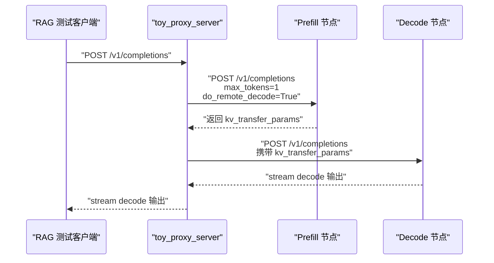
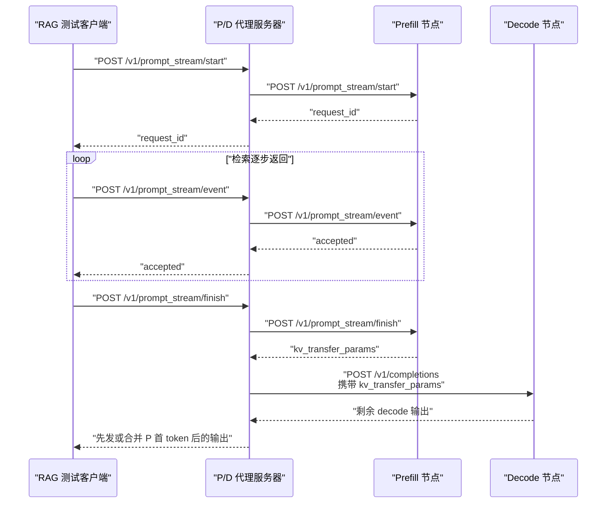
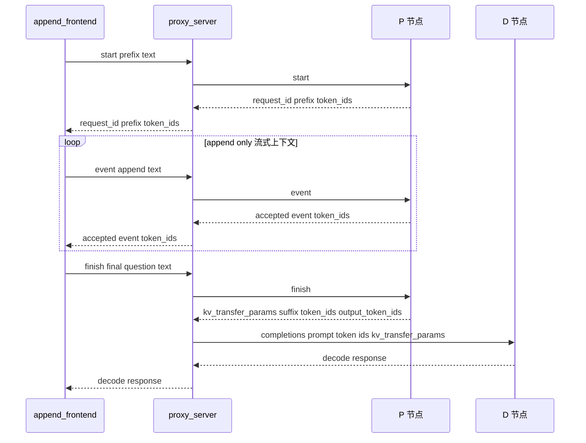

# 流式 Prefill 的 RESTFUL 接口设计

这份文档记录流式 prefill 的 RESTFUL 链路设计和当前第一版实现状态。目标是让 RAG 测试请求先发到 **P/D 分离代理服务器**，由代理服务器把 Append、Update 和最终用户问题转发给 P 节点，并在 prompt 封口后把 KV transfer 信息交给 D 节点继续 decode。

当前代码里已经有这些相关入口：

- `research/scripts/proxy_server.py`：当前实验用 P/D proxy，已经支持
  `/v1/prompt_stream/preflight|start|event|finish|abort`。
- `research/scripts/append_frontend.py`：最小 append-only 前端脚本，用于走通 start、append event、finish 和 D 侧 decode。
- `vllm/entrypoints/serve/prompt_stream/`：P 节点 RESTFUL router、协议模型和 serving 逻辑。
- `vllm/entrypoints/openai/api_server.py`：OpenAI-compatible server 的主入口。当前已经在 `build_app()` 中注册 prompt stream router。

当前实验 prompt-stream proxy 已明确收窄为 `api=completions`、`n=1`。
`stream=true` 时 proxy 先发送 P 的首 token SSE，再转发 D 的后续 SSE；
`stream=false` 时合并 P/D 的非流式结果。chat renderer 的物理 token 镜像
尚未完成，因此 prompt-stream chat 请求仍会 fail closed。

当前流式 prefill 的核心矛盾是：**Append / Update 事件不是生成请求，不应该等待 completion response；它们应该是 ack 型状态更新接口。** 因此不能直接把所有事件都塞进现有 `/v1/completions`。

## 当前 P/D proxy 的现有语义

`toy_proxy_server.py` 当前流程是一次性 P/D 请求：



这个模型假设 P 请求会返回一次 completion response，并且 proxy 可以从 response 中拿到 `kv_transfer_params`。流式 prefill 不符合这个模型，因为 Append / Update 事件应该只是更新 P 节点上的长期 `Request` 状态。

## 新的会话模型

流式 prefill 需要把一个 RAG 请求拆成三个阶段：

- **Start**：创建 P 节点上的长期请求，保存固定 prefix/template。
- **Event**：多次提交 Append / Update / Source Finished 事件，只返回 ack。
- **Finish**：提交最终用户问题，P 节点完成最后 prefill，产生 `kv_transfer_params`，然后 D 节点继续 decode。
- **Preflight**：在创建会话前，用 P 的真实 tokenizer、block size 和
  segment padding 规则估算完整事件序列的最大物理长度。

整体流程如下：



这个设计保持一个原则：**P 节点负责流式 prefill 状态，D 节点只接收最终 KV 后继续 decode。**

## 代理服务器 RESTFUL 设计

代理服务器是 RAG 测试客户端唯一直接访问的入口。测试代码不直接访问 P 节点或 D 节点。

### 会话状态

`toy_proxy_server.py` 需要新增一个会话表：

```python
app.state.prompt_stream_sessions = {
    request_id: {
        "prefill_client": prefill_client_info,
        "decode_client": decode_client_info,
        "api": "/completions",
        "base_request": {...},
    }
}
```

这个会话表的作用是：

- 固定一个请求对应的 P 节点，后续所有 Append / Update 都必须发到同一个 P。
- 固定一个请求对应的 D 节点，finish 后把 KV 交给同一个 D。
- 保存原始生成请求参数，例如 `model` 和采样参数。
- 避免每个事件都重新 round-robin 到不同 prefiller。

### `POST /v1/prompt_stream/preflight`

用途：在正式回放和 QPS 计时之前检查一个完整样本是否超过 P/D 的最大序列
长度。请求包含 start prompt 和原始分段事件：

```json
{
  "model": "local-completions",
  "prompt": "通用模板",
  "events": [
    {
      "source_id": "anns",
      "event_type": "append",
      "source_type": "append",
      "text": "chunk"
    },
    {
      "source_id": "question",
      "event_type": "prompt_finished",
      "text": "最终问题"
    }
  ]
}
```

P 节点对 start prompt 使用 `add_special_tokens=true`，对每个事件分别使用
`add_special_tokens=false`。`max_required_sequence_tokens` 是按实际分段
状态机得到的**最大运行序列上界**：它会比较 Update 各版本和 finish 阶段可能
达到的峰值，并计入 `PREFIX_APPEND` 尾部 segment padding，以及为 P 首输出
token 预留的 `+1` 位置。它不是纯逻辑 prompt token 数。响应核心字段为：

```json
{
  "block_size": 16,
  "server_max_model_len": 4096,
  "final_physical_prompt_tokens": 2048,
  "max_required_sequence_tokens": 2049,
  "fits_server_max_model_len": true
}
```

该接口无状态，不创建长期 Request，也不计入实验 TTFT。

### `POST /v1/prompt_stream/start`

用途：创建一个流式 prefill 会话，并在 P 节点创建长期 Request。

请求示例：

```json
{
  "api": "completions",
  "model": "local-completions",
  "prompt": "通用模板或 system prefix",
  "stream": true,
  "max_tokens": 128,
  "temperature": 0,
  "request_id": "optional-user-request-id"
}
```

字段说明：

| 字段 | 含义 |
| --- | --- |
| `api` | 当前必须是 `completions`。 |
| `model` | 传给 vLLM 的模型名。 |
| `prompt` | 固定 prefix/template。Start 阶段可以继续使用普通 prompt 文本，由 P 节点走现有输入处理链路完成 tokenize。 |
| `stream` | 客户端可使用 `false` 获取 JSON，或使用 `true` 获取 SSE。proxy 发往 P 的内部 start 固定为非流式 collector；该字段只决定 proxy 返回结果及 D decode 的响应模式。 |
| `max_tokens` | D 节点 decode 的最大 token 数；P 节点 start 阶段不会真正 decode。 |
| `request_id` | 可选。没有提供时由 proxy 生成稳定 request id。 |

返回示例：

```json
{
  "request_id": "ps-8b9c...",
  "status": "started",
  "token_ids": [101, 102, 103]
}
```

`token_ids` 是 P 节点 tokenizer 得到的 prefix 镜像；finish 时还会用 P 返回的
完整物理 prompt 再次校准，避免 proxy 猜测 padding 或 Update 布局。

代理服务器行为：

- 生成或读取稳定 `request_id`。
- round-robin 选择一个 P 节点和一个 D 节点。
- 保存会话表。
- 转发到 P 节点的 `/v1/prompt_stream/start`。
- 不联系 D 节点。

### `POST /v1/prompt_stream/event`

用途：提交 Append、Update 或 Source Finished 事件。这个接口只返回 ack，不返回模型输出。

请求示例：

```json
{
  "request_id": "ps-8b9c...",
  "event": {
    "source_id": "retriever_0",
    "event_type": "update",
    "source_type": "update",
    "chunk_id": "retriever_0_v2",
    "version": 2,
    "sequence_no": 2,
    "text": "检索到的一段文本。",
    "token_ids": null,
    "arrival_time": 123.45
  }
}
```

也可以直接传 token ids，便于测试精确控制 LCP：

```json
{
  "request_id": "ps-8b9c...",
  "event": {
    "source_id": "retriever_0",
    "event_type": "update",
    "source_type": "update",
    "chunk_id": "retriever_0_v2",
    "version": 2,
    "sequence_no": 2,
    "text": null,
    "token_ids": [101, 102, 103],
    "arrival_time": 123.45
  }
}
```

代理服务器行为：

- 根据 `request_id` 查找会话。
- 补齐 `event.request_id`，确保和外层 `request_id` 一致。
- 把事件转发到会话绑定的 P 节点。
- 不在 proxy 层做 tokenization；文本到 token ids 的转换由 P 节点完成，避免 proxy 和 P 使用不同 tokenizer。
- 返回 P 节点 ack。
- 不联系 D 节点。

返回示例：

```json
{
  "request_id": "ps-8b9c...",
  "status": "accepted",
  "event_type": "update",
  "token_ids": [101, 102, 103]
}
```

### `POST /v1/prompt_stream/finish`

用途：提交最终用户问题，触发 P 节点完成最后 prefill，并把返回的 `kv_transfer_params` 交给 D 节点继续 decode。

请求示例：

```json
{
  "request_id": "ps-8b9c...",
  "event": {
    "source_id": "final_question",
    "event_type": "prompt_finished",
    "source_type": null,
    "chunk_id": "final_question_0",
    "version": 0,
    "sequence_no": 0,
    "text": "用户最终问题是什么？",
    "token_ids": null,
    "arrival_time": 130.0
  }
}
```

测试也可以直接传最终用户问题的 token ids：

```json
{
  "request_id": "ps-8b9c...",
  "event": {
    "source_id": "final_question",
    "event_type": "prompt_finished",
    "source_type": null,
    "chunk_id": "final_question_0",
    "version": 0,
    "sequence_no": 0,
    "text": null,
    "token_ids": [2001, 2002, 2003],
    "arrival_time": 130.0
  }
}
```

代理服务器行为：

- 根据 `request_id` 查找会话。
- 转发 `PROMPT_FINISHED` 到绑定的 P 节点。
- P 节点完成最终用户问题 prefill，并返回 `kv_transfer_params`。
- proxy 用 P 返回的物理 `prompt_token_ids` 完全替换自己的逻辑 token 镜像，
  再追加 P 已采样的首 token。
- proxy 把 `kv_transfer_params` 写入最初保存的 `base_request`，并设置
  `add_special_tokens=false`。
- proxy 调用绑定的 D 节点 `/v1/completions`。
- proxy 把 P 首 token 合并进 D 节点输出，再返回给 RAG 测试客户端。

`stream=false` 返回合并后的 JSON；`stream=true` 先发送 P 首 token 的
completions SSE chunk，再转发 D 的剩余流。prompt-stream chat 请求仍返回 400。

### `POST /v1/prompt_stream/abort`

用途：取消一个还没 finish 的流式 prefill 请求。

请求示例：

```json
{
  "request_id": "ps-8b9c..."
}
```

行为：

- 活跃会话：proxy 先把 abort 转发给绑定的 P 节点；只有 P 确认 abort 后，
  才删除本地 session 并返回 `status=aborted`。若上游请求失败，proxy 保留
  session，使客户端可以重试，不会把仍存活的 P 请求伪装成已清理。
- 已 finish 或已经 abort 的会话：不再访问上游，幂等返回 200 和
  `status=already_finished_or_aborted`。

因此 replay 在 D/NIXL 失败后的 finally 清理不会再把正常的“session 已经结束”
误报为 404。若 finish 已经发往 D，当前实验 proxy 仍没有独立 D request id
来取消在途 decode，这是后续事项。

## Stream2LLM 的参考结论

Stream2LLM 的实验脚本没有走 RESTFUL，而是直接创建 `EngineCoreClient`，手工构造 `EngineCoreRequest` 后送进 EngineCore。它的关键路径是：

```text
experiments/crawler/stream_client.py
  -> make_stream_request() / append_stream_request() / update_stream_request()
  -> EngineCoreRequest
  -> EngineCoreClient.add_request_async() 或 create_stream_request_async()
  -> EngineCore.add_request()
```

它的 client 侧维护了两个东西：

- **输入队列**：后续 Append / Update 通过同一个 queue 持续送入 EngineCore。
- **输出队列**：start 时按 `request_id` 注册，finish 后从这个队列等待第一个 decode output。

EngineCore 侧的逻辑是：

```text
如果 request_id 已经在 scheduler 中：
    把新 EngineCoreRequest 当作流式 prompt 事件
    对 existing Request 做 append 或 update
    不创建新的长期 Request
否则：
    创建新的 Request 并加入 scheduler
```

我们不想让 RAG 测试直接操作 `EngineCoreClient`，但可以复用这个结构思想：

- RESTFUL proxy 的会话表相当于 Stream2LLM 的输入 queue。
- P 节点 serving 层的 session state 相当于 Stream2LLM 的输出 queue 注册。
- `/event` 只负责把事件送进 EngineCore，不应该创建新的输出 collector。
- `/finish` 送入 `PROMPT_FINISHED` 后，从 start 阶段注册的 collector 等待 `kv_transfer_params`。

这比“每个事件都调用普通 generate”更稳定，也更接近 Stream2LLM 已经验证过的控制流。

## P 节点 RESTFUL 设计

P 节点接口应该挂在 OpenAI-compatible server 上，而不是旧的 `vllm/entrypoints/api_server.py` demo server。

推荐新增一个独立 router，例如：

```text
vllm/entrypoints/serve/prompt_stream/api_router.py
vllm/entrypoints/serve/prompt_stream/protocol.py
vllm/entrypoints/serve/prompt_stream/serving.py
```

然后在 `vllm/entrypoints/openai/api_server.py` 的 `build_app()` 中注册：

```python
from vllm.entrypoints.serve.prompt_stream.api_router import (
    attach_router as attach_prompt_stream_router,
)

attach_prompt_stream_router(app)
```

这样做的好处是：

- 不把实验逻辑塞进 OpenAI server 主文件。
- 保持和现有 `serve/disagg/api_router.py` 类似的组织方式。
- 后续可以独立删除或隐藏这个实验接口。

### `POST /v1/prompt_stream/start`

P 节点收到 start 后，需要创建长期 Request，并注册后续 finish 阶段要读取的输出 collector，但 HTTP handler 本身只返回 ack。

推荐第一版采用类似 Stream2LLM 的控制流：

1. P 节点 route 对 start 请求做 tokenize，得到 prefix/template 的 token ids。
2. 构造普通的初始 `EngineCoreRequest`，其中 `prompt_stream_event=None`。
3. 调用一个新的 ack 型 engine client 方法，例如 `add_prompt_stream_request()`。
4. 这个方法内部需要完成两件事：
   - 把初始 `EngineCoreRequest` 送入 EngineCore。
   - 为该 `request_id` 注册 output collector，并保存在 P 节点 session state 中。
5. start 接口立即返回 `started`，不等待模型输出。

这里不要简单地调用普通 `/v1/completions` 或普通 `generate()` 后丢掉 generator。原因是输出 collector 的生命周期必须被显式保存，否则 finish 阶段无法可靠拿到 `kv_transfer_params`，也可能造成未消费队列堆积。

需要补的工程接口更像：

```python
collector = await engine_client.add_prompt_stream_request(
    request_id=request_id,
    request=engine_core_request,
    params=sampling_params,
)
app.state.prompt_stream_sessions[request_id].collector = collector
```

如果复用现有 V1 `AsyncLLM.add_request()`，它本身已经能创建 `RequestOutputCollector`，但 `EngineClient` protocol 目前没有暴露这个方法。因此更干净的做法是给 protocol 增加专门的 prompt stream 方法，而不是在 router 中依赖具体 `AsyncLLM` 类型。

### `POST /v1/prompt_stream/event`

P 节点收到 event 后，构造一个只携带 `prompt_stream_event` 的 `EngineCoreRequest`：

```python
EngineCoreRequest(
    request_id=request_id,
    prompt_token_ids=[],
    sampling_params=sampling_params,
    pooling_params=None,
    arrival_time=event.arrival_time,
    prompt_stream_event=prompt_stream_event,
)
```

这个请求进入 EngineCore 后的链路是：

```text
EngineCoreRequest(prompt_stream_event=event)
  -> EngineCore.preprocess_add_request()
  -> Request.from_engine_core_request()
  -> Request(prompt_stream_event=event)
  -> Scheduler.add_request()
  -> existing.apply_prompt_stream_event(event)
```

如果 `request_id` 已经存在，scheduler 会把这个临时 Request 当作事件载体，把事件应用到长期 Request 上。

注意点：

- 这个接口应该立即返回 ack，不等待模型输出。
- 对 Append / Update 事件，`sampling_params` 只需要满足构造 Request 的最低要求，不应该改变原始采样参数。
- `prompt_token_ids` 对事件请求没有业务意义，但当前 `Request` 构造需要 prompt token 字段。MVP 可以传空 list。
- event 不能再注册新的 output collector；collector 应该只在 start 阶段注册一次。
- 因此 event 更适合走一个 core-only 方法，例如 `engine_client.add_prompt_stream_event(request)`，内部只把 `EngineCoreRequest` 送到 EngineCore。
- 更干净的长期方案是给 `EngineCoreRequest` 增加更明确的 request type，例如 `PROMPT_STREAM_EVENT`，但第一版可以复用 `ADD`，依赖 scheduler 的 duplicate `request_id` 分支。

### `POST /v1/prompt_stream/finish`

P 节点收到 finish 后，需要先把 `PROMPT_FINISHED` 事件送进 EngineCore，然后等待 P 节点完成最后 prefill 并返回 `kv_transfer_params`。

这里和普通 event 的区别是：finish 需要一个 response，不能只 ack。

推荐行为：

- 构造 `EngineCoreRequest(prompt_stream_event=prompt_finished_event)`。
- 通过 core-only 方法把 `PROMPT_FINISHED` 事件送入 EngineCore。
- 从 start 阶段保存的 output collector 中等待首个 output。
- 从 output 中提取 `kv_transfer_params`。
- 返回给 proxy。

这个设计对应 Stream2LLM 的 `create_stream_request_async()`：start 阶段注册输出队列，后续事件只进输入队列，finish 后再从同一个输出队列拿首个 decode output。

返回示例：

```json
{
  "request_id": "ps-8b9c...",
  "status": "prefill_finished",
  "kv_transfer_params": {
    "do_remote_prefill": true,
    "do_remote_decode": false,
    "remote_block_ids": [[0, 1, 2]],
    "remote_num_tokens": 128,
    "remote_engine_id": "...",
    "remote_host": "...",
    "remote_port": 8100
  },
  "token_ids": [2001, 2002, 2003],
  "prompt_token_ids": [101, 102, 103, 103, 110, 111, 2001, 2002, 2003],
  "output_token_ids": [3001],
  "output_text": "答",
  "output_finish_reason": "length",
  "output_stop_reason": null
}
```

当前 serving 已经保存 start 阶段的 collector，并在 finish 后等待携带
`kv_transfer_params` 的唯一 completion branch。`prompt_token_ids` 是包含 PA
padding 的物理 prompt；`output_token_ids` 是 P 采样的首 token，二者语义不能
混用。

## D 节点 RESTFUL 适配

D 节点暂时不需要新增 prompt stream API。

D 节点继续使用现有接口：

```text
POST /v1/completions
```

proxy 在调用 D 节点前，把 P 返回的 `kv_transfer_params` 写入请求体：

```json
{
  "model": "local-completions",
  "prompt": [101, 102, 103, 103, 110, 111, 2001, 2002, 2003, 3001],
  "add_special_tokens": false,
  "stream": false,
  "max_tokens": 127,
  "kv_transfer_params": {
    "do_remote_prefill": true,
    "do_remote_decode": false,
    "remote_block_ids": [[...]],
    "remote_num_tokens": 128,
    "remote_engine_id": "prefill-engine"
  }
}
```

这里的 `prompt` 顺序是
`PA_physical + Update + Question + P sampled token`；`max_tokens` 需要扣除
P 已经采样并会合并回最终响应的 token 数。D 不接收逻辑文本重新 tokenize，
否则物理 padding 和远端 block 位置会失配。

OpenAI completion protocol 已经支持 `kv_transfer_params`，并会通过
`SamplingParams.extra_args` 传到 engine，因此 D 节点不需要新增 prompt stream
route。

## Event 文本与 token ids 双模式

RESTFUL 层需要支持两种事件内容输入方式：

- **文本模式**：RAG 前端传 `text`，P 节点 REST serving 层负责 tokenize。
- **token ids 模式**：测试或低层客户端直接传 `token_ids`，P 节点直接使用。

统一规则是：

```text
如果 token_ids != null:
    使用 token_ids
否则如果 text != null:
    P 节点使用当前模型 tokenizer 转成 token_ids
否则:
    返回 400 Bad Request
```

这意味着 `PromptStreamEvent` 仍然只需要保存 `token_ids`。`text` 是 RESTFUL 协议层字段，不应该继续传到 `EngineCoreRequest` 之后。

推荐事件模型可以先设计成：

```python
class PromptStreamEventRequest(BaseModel):
    source_id: str
    event_type: str
    source_type: str | None = None
    chunk_id: str | None = None
    version: int
    sequence_no: int
    text: str | None = None
    token_ids: list[int] | None = None
    arrival_time: float | None = None
```

注意点：

- proxy 不做 tokenization，只转发 `text` 或 `token_ids`。
- P 节点必须用和模型一致的 tokenizer 做文本到 token ids 的转换。
- 进入 `PromptStreamEvent` 后只保留 `token_ids`，Request / Scheduler 不处理文本。
- 测试 LCP 时优先传 `token_ids`，这样可以精确控制 update 源内 LCP。
- 真实 RAG 前端可以传 `text`，降低前端依赖 tokenizer 的复杂度。

## EngineCoreRequest 注入链路

当前代码中已经有字段：

```python
EngineCoreRequest.prompt_stream_event: PromptStreamEvent | None
```

RESTFUL 层最终要把 HTTP JSON 转成这个字段。

### JSON 到 PromptStreamEvent

HTTP event body 可以携带 `text` 或 `token_ids`：

```json
{
  "request_id": "ps-8b9c...",
  "event": {
    "source_id": "retriever_0",
    "event_type": "append",
    "source_type": "append",
    "chunk_id": "a0",
    "version": 0,
    "sequence_no": 0,
    "text": "一段检索文本",
    "token_ids": null,
    "arrival_time": 123.0
  }
}
```

P 节点 serving 层需要先把事件内容归一化为 token ids，再转换为：

```python
PromptStreamEvent(
    request_id=request_id,
    source_id=event.source_id,
    event_type=PromptStreamEventType(event.event_type),
    source_type=(
        PromptSourceType(event.source_type)
        if event.source_type is not None
        else None
    ),
    chunk_id=event.chunk_id,
    version=event.version,
    sequence_no=event.sequence_no,
    token_ids=resolved_token_ids,
    arrival_time=event.arrival_time,
)
```

### PromptStreamEvent 到 EngineCoreRequest

MVP 事件请求可以构造成：

```python
EngineCoreRequest(
    request_id=request_id,
    prompt_token_ids=[],
    prompt_embeds=None,
    prompt_is_token_ids=None,
    mm_features=[],
    sampling_params=session.sampling_params,
    pooling_params=None,
    arrival_time=event.arrival_time,
    lora_request=None,
    cache_salt=None,
    priority=0,
    trace_headers=None,
    resumable=False,
    reasoning_ended=None,
    reasoning_parser_kwargs=None,
    abort_immediately=False,
    prompt_stream_event=prompt_stream_event,
)
```

注意：

- `request_id` 必须和 start 阶段一致。
- Append / Update 事件的 `prompt_token_ids=[]` 只是占位，真正内容在 `prompt_stream_event.token_ids`。
- start 阶段的 `EngineCoreRequest` 需要携带真实 prefix token。
- finish 阶段的 `EngineCoreRequest` 也主要通过 `prompt_stream_event.token_ids` 携带最终用户问题。
- 如果 RESTFUL 请求传入的是 `text`，必须在构造 `PromptStreamEvent` 前完成 tokenize。

## 设计上的关键取舍

### 为什么不直接复用 `/v1/completions`

不建议让 Append / Update 事件复用 `/v1/completions`，原因是：

- completions 的语义是请求模型输出，而 Append / Update 只是状态更新。
- 如果 Append / Update 走 completions，请求会等待输出，容易挂住。
- proxy 无法清楚区分“只要 ack 的事件”和“需要转 D decode 的最终请求”。
- OpenAI-compatible API 会被实验语义污染，后续很难维护。

### 为什么代理服务器要保存会话

流式 prefill 的所有事件必须落到同一个 P 节点上的同一个长期 Request。若每个事件都 round-robin 到不同 P 节点，会出现：

- 后续事件找不到原始 Request。
- Append / Update 状态丢失。
- P 节点 KV cache 不连续。
- finish 阶段无法从对应 collector 拿到完整 `kv_transfer_params`。

因此 request id 到 prefiller 的绑定必须在 proxy 层保存。

### 为什么 P 节点需要 ack 型接口

Append / Update 事件进入 EngineCore 后，scheduler 只会更新长期 Request，不应该产生用户可见输出。

如果 REST handler 等待普通 output generator，就可能出现：

- 没有 `PROMPT_FINISHED` 时 decode barrier 阻止输出，HTTP 请求一直不返回。
- 多个 Append / Update HTTP 请求堆积。
- 测试很难判断事件是否已经被 engine 接受。

ack 型接口可以把“事件已进入 scheduler”作为完成条件。

## 最小可测链路

第一版测试可以只支持 completions。测试为了精确控制 LCP，建议事件使用 token ids；真实 RAG 客户端可以使用文本模式：

```text
POST /v1/prompt_stream/start
  prompt = prefix tokens 对应文本

POST /v1/prompt_stream/event
  APPEND source_id = append_0, token_ids = [1, 2]

POST /v1/prompt_stream/event
  UPDATE source_id = update_0, token_ids = [10, 11, 12]

POST /v1/prompt_stream/event
  UPDATE source_id = update_0, token_ids = [10, 11, 99]

POST /v1/prompt_stream/finish
  PROMPT_FINISHED token_ids = [20, 21]
```

需要验证：

- proxy 会把所有事件转发到同一个 P 节点。
- P 节点 scheduler 能找到同一个长期 `Request`。
- Update 的 LCP 使用 update 源内 LCP。
- `PROMPT_FINISHED` 后 P 返回 `kv_transfer_params`。
- D 节点能使用这些 `kv_transfer_params` 继续 decode。

## 历史实现顺序

下面是第一版实现时采用的顺序，大部分已经完成，保留在这里方便回看工程路径：

- 在 `toy_proxy_server.py` 中加会话表和 `/v1/prompt_stream/start|event|finish|abort`。
- 新增 `vllm/entrypoints/serve/prompt_stream/protocol.py`，定义 P 节点 REST 请求模型。
- 新增 `vllm/entrypoints/serve/prompt_stream/api_router.py`，实现 P 节点 REST endpoint。
- 在 `vllm/entrypoints/openai/api_server.py` 的 `build_app()` 中 attach prompt stream router。
- 给 `EngineClient` protocol 增加 prompt stream 专用方法：start 注册 collector，event core-only 入队，finish 复用 collector 等待输出。
- 先实现 `/start` 的 collector 注册和 `/event` 的 core-only ack 路径，再实现 `/finish` 等待 `kv_transfer_params` 的路径。
- 最后写 P/D proxy 集成测试。

## 当前未解决的问题

- **真实 NIXL 验证**：两段 block 导出、D local load block 裁剪和长度校验已
  实现，但尚未在真实双 GPU 环境复测输出质量。
- **collector 生命周期**：start 后如果长时间没有 finish，需要 session TTL 或 abort 清理 collector、Request 和 KV。
- **请求超时与清理**：Append / Update 接口 ack 后，如果客户端不 finish，需要靠 abort 或 session TTL 清理 P 侧 Request 和 KV。
- **chat completions 支持**：第一版实现仍建议只用 completions；chat 需要处理 template、messages 和最终用户问题的位置。
- **streaming response 边界**：completions 的 `stream=true` 已能先发送 P 首 token
  并继续转发 D SSE；chat completions 的模板渲染与流式合并仍未实现。
- **Update 事件的 RESTFUL 测试**：`update_frontend.py` 和
  `mixed_frontend.py` 已完成单请求 smoke test；大规模并发回放仍需在本轮 exact
  manifest 修复后重新验证。
- **多 P/D 节点一致性**：proxy 会话表是内存状态，测试足够；生产需要外部 session store 或 sticky routing。

## 当前实现同步

目前 RESTFUL 链路已经有第一版实验实现，Append、Update 和混合来源均有单请求
smoke test；大规模回放所需的长度预检与 exact KV 传输保护已经落到代码，仍需
在真实双 GPU 环境重新验证吞吐与输出质量。

已经完成的部分包括：

- `research/scripts/proxy_server.py` 已经实现实验用代理服务器，提供
  `/v1/prompt_stream/preflight`、`/start`、`/event`、`/finish` 和 `/abort`。
- `vllm/entrypoints/serve/prompt_stream/api_router.py`、`protocol.py` 和 `serving.py` 已经提供 P 节点 RESTFUL 入口。
- `vllm/entrypoints/openai/api_server.py` 已经注册 prompt stream router，因此 P 节点和 D 节点启动同一个 OpenAI-compatible server 后都能看到 `/v1/prompt_stream/*` 路由。
- `EngineClient` / `AsyncLLM` 已经补了 prompt stream 专用方法：
  - `add_prompt_stream_request()`：start 阶段创建长期 Request 和 output collector。
  - `add_prompt_stream_event()`：event / finish 阶段把事件送入 EngineCore，不额外创建普通 output queue。
- P 节点 start / event / finish 响应会返回 tokenizer 后的 `token_ids`，proxy 用这些 token ids 维护 D 侧最终 prompt 镜像。
- P 节点 finish 响应会返回 `kv_transfer_params`，同时返回 P 侧 prefill 过程中已经生成的 `output_token_ids`。
- proxy 在启用 KV transfer 时，会把 P 侧 `output_token_ids` 追加进 D 侧 prompt token ids，并相应减少 D 侧 `max_tokens`。
- proxy 增加了 `--disable-kv-transfer` 调试开关，用来让 D 节点本地计算完整 prompt，作为排除 tokenization / prompt 组装问题的基线。

当前实际链路可以概括为：



需要特别注意：D 节点并不知道 `PromptStreamState`，也不会理解 prefix / append / update / suffix 的逻辑分段。D 节点只根据普通 completions 请求里的 prompt token ids 和 `kv_transfer_params` 拉取远端 KV。因此 RESTFUL 层必须保证：

- D 侧 prompt 的远端前缀和 P 暴露给 KV transfer 的 token 位置严格一致。
- P 侧采样的第一个 output token 必须进入 D prompt；它尚未拥有 KV 时由 D
  本地 forward。
- D 侧 `max_tokens` 要扣掉已经由 P 侧采样并最终合并回响应的 token 数量。
- `kv_transfer_params.remote_num_tokens` 必须和 D 侧准备命中的远端 token 数一致。

## 当前 KV transfer 实现结论

前一轮定位证明启用 NIXL 后的异常来自 KV/token/block 对齐，而不是单纯的 REST
路由。当前实现已经针对这个问题改为两段物理 KV：

```text
PREFIX_APPEND = prefix + append + block 对齐 padding
UPDATE        = update + final question + 后续 decode token
```

P 节点 finish 时按 `PREFIX_APPEND block ids + UPDATE block ids` 导出。exact
prompt-stream transfer 只允许一种远端覆盖范围：

```text
remote_num_tokens = physical_prompt_len
D_prompt_len = physical_prompt_len + prefill_output_tokens
prefill_output_tokens in {0, 1}
block_count[group] = ceil(physical_prompt_len / block_size[group])
```

P 采样的首 token 是本轮 forward 的输出，尚未作为输入写入 KV，因此不属于
远端 manifest。D 先拉取完整物理 prompt KV，再在本地 forward 这个可选的
`0/1` 个 tail token。即使物理 prompt 恰好 block 对齐，D 为 tail token 申请的
额外 block 也不会被误算为远端 block。

proxy、D scheduler 和 NIXL worker 会逐层执行 fail-closed 校验：

- exact 标志和 manifest 字段类型必须正确，计数、block size 和 block id
  必须是有效整数。
- `remote_block_ids`、manifest 和 D KV 配置的 group 数必须一致。
- 每个 group 的远端、D 本地和 manifest block 数必须一致，P/D block size
  必须一致。
- `remote_num_tokens` 必须严格等于 `physical_prompt_len`。
- D prompt token 数必须严格等于物理 prompt 加 manifest 声明的 `0/1` 个
  P 输出 token。

任一条件不满足时，只把当前请求标记为 KV load 失败，不启动错误的 NIXL
复制，也不通过断言结束整个 EngineCore。

D 返回后，proxy 会把 P 首 token 的文本和 token id 合并回最终 completions
响应，并调整 usage。finish 成功后，P 和 proxy 都会清理长期 session。

尚未完成的是在真实双 GPU NIXL 环境重新验证这套 segment block table。下一轮
联调应同时记录：

```text
physical_prompt_len
D_prompt_len
remote_num_tokens
remote_block_ids
D local load block ids
```

如果输出仍异常，再检查 NIXL 实际 descriptor 的远端/本地 block id 对和每层
复制内容，而不是继续修改 tokenization 镜像。
